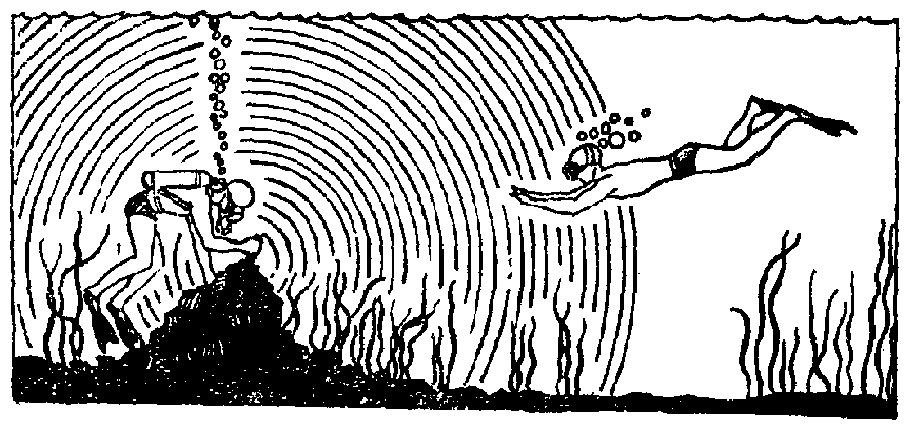

---
{
  "schema": "ld-s10y-lesson/page@3",
  "book": "10p",
  "page": 116,
  "printed_page": 106,
  "render": {"dpi": 300},
  "notes": [
    "页首p cont承接115权威尾句“引起耳朵附近压强”；不重读115像素。",
    "声振动、声学就是关于声音的知识和不同媒质中的声波保留原书粗体，段首粗体与正文同一印刷行。",
    "图77整体包含水面、水下两个人、相撞石块、气泡、波纹、底部岩石和水草；图题单独转写，不进入裁图。",
    "历史人物首字母印成H/M形，像素不能区分拉丁H/M与西里尔Н/М；按苏联姓名记为Н·М，字母脚本仍属SOURCE不确定项，未推断人物身份或改名。",
    "页尾p open在“用手轻敲尺的另”处截断，续117；本页无新标题、习题、表格或解释性脚注。图引用非排他，不认领唯一归属。"
  ],
  "errata": []
}
---

<!-- p cont -->
的周期性振动，这种振动再作用于我们的听觉器官。

<!-- p -->
我们的耳朵能以声音的形式感觉到的振动频率介于17—
20到20000赫兹之间。这样的振动叫做**声振动**。**声学就是
关于声音的知识**。尺的伸出端越短，它的振动频率就越高，所
以，当尺端足够短时，我们才开始听到声音。

<!-- p -->
任何一种物体（固态的、液态的或气态的），当它以声频振
动时，它就在周围媒质中形成声波。

<!-- p -->
**不同媒质中的声波**　我们全身都泡在水里的时候是很
少的，声波最经常的是通过空气传到我们的耳朵里。当然，空
气与其他媒质在传播声波方面相比，并没有什么突出的优点。
声在水中传播，在固体中也传播。游泳的时候，把头扎入水
中，你们就能听见水中远距离处发生的两块石头相撞的声音
（图77）。

<!-- fig 图 77 box 190,1155,1095,510 -->

<!-- cap 图 77 -->
图77

<!-- p -->
大地能很好地传声，著名的历史学家Н·М·卡拉姆岑说，
在库利阔夫斯基战役之前，德米特里·顿斯科把耳朵贴在地
面上，当敌人的骑兵队还没有出现时，他就听到马蹄声了。

<!-- p open -->
如果把长木尺的一端紧紧地贴在耳边，用手轻敲尺的另

<!-- foot -->
106
