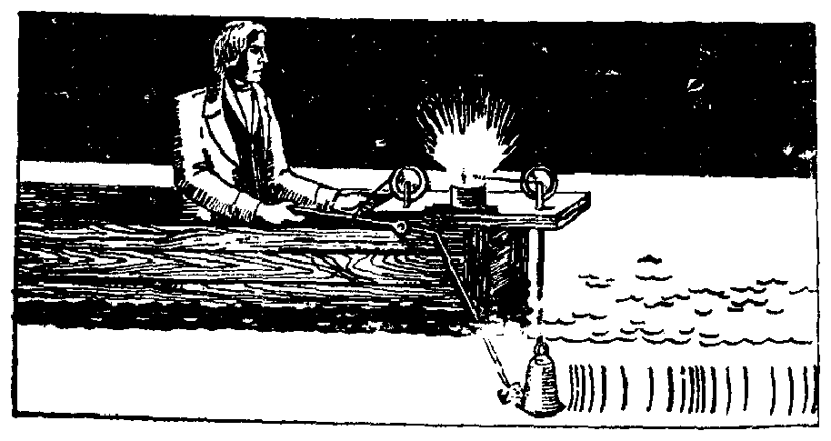

---
{
  "schema": "ld-s10y-lesson/page@3",
  "book": "10p",
  "page": 118,
  "printed_page": 108,
  "render": {"dpi": 300},
  "notes": [
    "页首p cont接117的“听躯体内的声”，此句后41节闭合；42.声速为实际印刷标题。",
    "图80为跨118–119页图，本页仅左半，右半保存在119；框内保留船、实验者、火药闪光、敲钟装置、浸水钟、水面和水中声波，不补画右半。",
    "图题在118仅印“图”，119仅印“80”；本页cap open、119 cap cont保存两个实际片段。图号80由两页可见题字共同确定，非位置猜测。",
    "两半图在不同物理页的native work目录中各保存为fig-80；这是同一图的两个source片段，不是两张完整图，不装订、提升或覆盖全书图库。",
    "本页末正文“飞机才开始以超音速飞行。”结束，不是119首段的open；图80跨页状态单独记录。",
    "本页无习题、表格或解释性脚注；300000千米/秒与0°C、331米/秒按原文保留，未据现代数值改写。"
  ],
  "errata": []
}
---

<!-- p cont -->
音，就可以得到心脏和其他内脏功能的重要情况。

<!-- h3 -->
42. 声速

<!-- p -->
声波如同一切其他波一样，是以有限速度传播的。可以
用以下方法来发现这一点。光是以极大的速度传播的（300000
千米/秒）。所以射击时的火光几乎瞬间就传到了眼里。而射
击的音响传来就显著地慢得多。在远距离看足球赛时，也可
以发现上述情况。你们看见了踢球的动作，但踢球的声音
得过一段时间才能传来。大概所有的人都知道，闪电的火花
先于隆隆的雷声。如果在远处发生大雷雨，则雷声要迟到几
十秒钟之久。并且，由于声的有限速度的缘故，还会发生回
声。回声是由森林边缘，陡削的河岸和建筑物等等反射回来
的声波。

<!-- p -->
在0°C的空气中，声的速度等于331米/秒。这个速度是
够大的了。仅仅在不久前，飞机才开始以超音速飞行。

<!-- fig 图 80 box 425,1430,900,470 open -->

<!-- cap 图 80 open -->
图

<!-- foot -->
108
