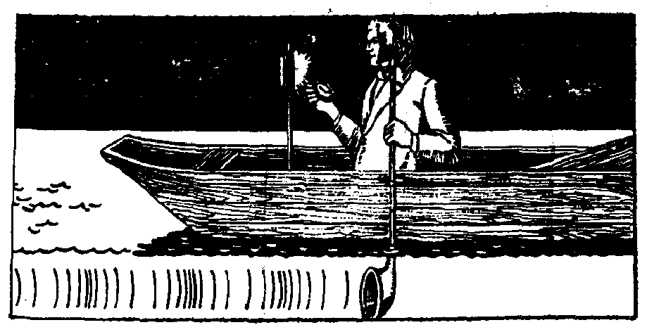

---
{
  "schema": "ld-s10y-lesson/page@3",
  "book": "10p",
  "page": 119,
  "printed_page": 109,
  "render": {
    "dpi": 300,
    "w": 1536,
    "h": 2337,
    "sha256": "5af5e1ddf15011d2c607274118b66cfbfce223faa1b5214aefdec6ba02fedca2"
  },
  "notes": [
    "页首另起新段，不是118末正文的cont；保留与空气密度无关、分子质量关系和氢、二氧化碳中的数值。",
    "0°C时氢中声速1270米/秒，1827年、14公里、8°C与1435米/秒，15°C与4980米/秒均为本页原印数据，不据现值修订。",
    "图80仅右半，承接118的左半；保留船、持竖杆的实验者、水面、波纹、下垂的听音喇叭及伸入水中的部分，不补画左半，不将两半当两张完整图。",
    "图题仅印80，用cap cont接118的图；native两半同名但在不同物理页的work目录，禁止仅取一半提升或覆盖全书图库。",
    "最后p open在“前者是由钢轨传”处续120，中间图与图题不闭合此正文；未读取120像素或推断续文。",
    "页底少量淡扫描污点不作为正文；本页无习题、表格或解释性脚注，图80引用非排他，不认领唯一使用者。"
  ],
  "errata": [],
  "source": {
    "pdf": "10p 苏联中学课本 物理 十年级 .pdf",
    "pdf_sha256": "7190041b66182e5f6c5a4ef7ae0b04ee3f1afa0df1f5b3ff6317b2c2d1cb8f40",
    "pdf_page": 119
  },
  "profile": {
    "id": "soviet-cn",
    "sha256": "c364d68442cfccc9920d3e23932d418c3d7b123cf4a47408e6535dcb19f7104a"
  },
  "printed_lines": 17,
  "figures": [
    {
      "id": "fig-80",
      "label": "图 80",
      "box": [
        190,
        1350,
        895,
        448
      ]
    }
  ],
  "provenance": {
    "cap": "1",
    "normalized": true
  }
}
---

<!-- p -->
声在空气中的速度与空气的密度无关。此速度近似地等
于分子热运动的平均速度，并且与热运动的平均速度类似，也
与绝对温度的平方根成正比。气体的分子质量越大，声在气
体中的速度越小。0°C时声在氢中的速度为1270米/秒，而
在二氧化碳中是258米/秒。

<!-- p -->
声在水中的速度比在空气中的速度大。1827年在瑞士的
日内瓦湖上，对声速作了首次测量。在一只船上点燃火药，并
同时在水下敲钟；在距离这只船14公里的地方停着另一只
船。用沉入水中的喇叭来接收声音（图80）。根据闪光和声
音信号到达的时间差别，求出声的速度。温度在8°C时，声音
在水中的速度等于1435米/秒。

<!-- p open -->
在固体中声速比在液体中还要大。例如在钢中，15°C时
声速为4980米/秒。声速在固体中比在空气中大，可以用以
下方法发现。让你的助手敲一下钢轨的一端，而你把耳朵贴
在钢轨的另一端，你可以听到两个敲打声，前者是由钢轨传

<!-- fig 图 80 box 190,1350,895,448 cont -->

<!-- cap 图 80 cont -->
80

<!-- foot -->
109
