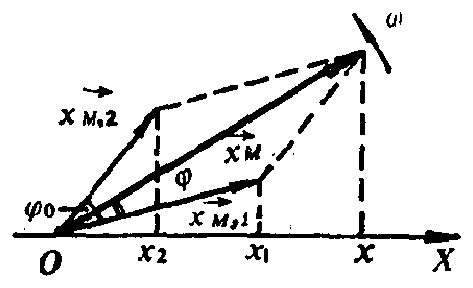

---
{
  "schema": "ld-s10y-lesson/page@3",
  "book": "10p",
  "page": 71,
  "printed_page": 61,
  "source": {
    "pdf": "10p 苏联中学课本 物理 十年级 .pdf",
    "pdf_sha256": "7190041b66182e5f6c5a4ef7ae0b04ee3f1afa0df1f5b3ff6317b2c2d1cb8f40",
    "pdf_page": 71
  },
  "render": {
    "dpi": 300,
    "w": 1536,
    "h": 2337,
    "sha256": "0e58410622e0d00966fc2abaae72b67601579425d97adae97b188e766a2752a3"
  },
  "notes": [
    "FIRST visual author candidate only; no independent source approval. Incoming N26 context is the frozen author-only candidate70 tail.",
    "Amplitude subscripts are transcribed as Cyrillic м from the printed italic glyph; the raster cannot establish a Unicode codepoint. Independent source review must confirm this typography.",
    "Figure 44 preserves all source labels in the native crop, including vector arrows, O, X, x_2, x_1, x, φ_0, φ and ω. No figure labels are redrawn or corrected.",
    "Printed emphasis and the two round page-number ornaments are retained. No erratum or physics-derived correction is asserted."
  ],
  "errata": [],
  "profile": {
    "id": "soviet-cn",
    "sha256": "54c02ea7d234571bd2d87c14289640701d1aa7ada4c3aed67403cec26680cddc"
  },
  "printed_lines": 25,
  "figures": [
    {
      "id": "fig-44",
      "label": "图 44",
      "box": [
        530,
        1192,
        449,
        264
      ]
    }
  ],
  "provenance": {
    "cap": "1",
    "normalized": true
  }
}
---

<!-- p cont -->
$U_{м}^2=I_{м}^2\left[R^2+\left(\omega L-\frac{1}{\omega C}\right)^2\right]$ （2.34）

<!-- p -->
为了得到等式（2.34）必须掌握彼此间有相位差的电压振荡的相
加.

<!-- p -->
利用**矢量图**来做几个简谐振荡的相加是最简单的.

<!-- p -->
这种方法的思路建立在两个极简单的原理上.

<!-- p -->
第一，如你们从第7节知道的，模为$x_{м,1}$的以恒定角速度旋转的矢
量的投影做简谐振荡：
$x_1=x_{м,1}\cos\omega t$ （2.35）

<!-- p -->
第二，在两个矢量相加时，合矢量的投影等于两个相加矢量的投影
的和.

<!-- p -->
若把两个频率相同，但振幅和相位不同的简谐振动相加，第二个振
动对第一个振动的相位差为$\varphi_0$并用下式表示：
$x_2=x_{м,2}\cos(\omega t+\varphi_0)$ （2.36）
两个振动中的每一个都可以看作为以角速度$\omega$旋转的相应的矢量的投
影，并且第二个矢量与第一个矢量的夹角为$\varphi_0$（图44）. 合位移$x$等于
位移$x_1$和$x_2$的和：
$x=x_{м,1}\cos\omega t+x_{м,2}\cos(\omega t+\varphi_0)$ （2.37）

<!-- fig 图 44 box 530,1192,449,264 -->

<!-- cap 图 44 -->
图44

<!-- p -->
根据第二个原则，以角速度$\omega$旋转的合矢量的投影为：
$x=x_{м}\cos(\omega t+\varphi)$ （2.38）
其中$x_{м}$是合矢量的模，而$\varphi$是这个矢量与投影为$x_1$的矢量之间的夹
角，这个角决定了合振动对$x_1$振动的相位差.

<!-- p -->
**利用矢量表示简谐振动和简谐振动各量之间的关系的图形叫做矢**
**量图.**

<!-- foot -->
• 61 •
