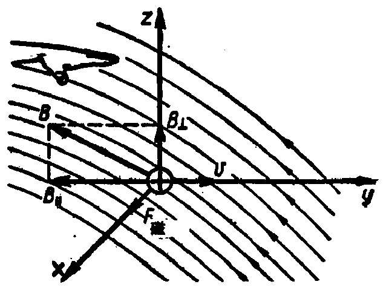
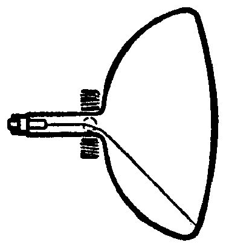
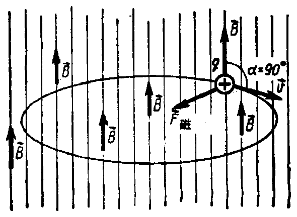

---
{
  "schema": "ld-s10y-lesson/page@3",
  "book": "9p",
  "page": 298,
  "printed_page": 289,
  "source": {
    "pdf": "9p 苏联中学课本 物理 九年级.pdf",
    "pdf_sha256": "df0ea9c3417b7ba0166872b33a8ec81ef20cfb9e15b512a44993174fe92162c0",
    "pdf_page": 298
  },
  "render": {
    "dpi": 300,
    "w": 1504,
    "h": 2289,
    "sha256": "3651c7f7667c226b7f4213858ca9ad1ee2e38e2a986b2f5316c09775705c0079"
  },
  "profile": {
    "id": "soviet-cn",
    "sha256": "c364d68442cfccc9920d3e23932d418c3d7b123cf4a47408e6535dcb19f7104a"
  },
  "notes": [
    "AUTHOR only. The first paragraph continues the permitted page297 author fact ending 则跟; page297 pixels were not opened and no approval is inherited.",
    "The first two rows and 方向 at the start of the third row continue the bold left-hand rule. 洛仑兹力 has four printed under-dots, represented by inline text-emphasis markup.",
    "Figure269's caption shares the row with 观察到洛仑兹力对运动. The paragraph continues beneath the figure.",
    "The actual next heading is two printed bold rows: 122. 电子的荷质比的测定 回旋加速器, then （阅读教材）. No ancestor heading or TOC title is supplied.",
    "The final paragraph remains open after 根据. Figures270 and271 and their side-by-side captions are transparent to that continuation.",
    "Source claims and the source spelling 显象管 are historical transcription, not modern scientific corrections.",
    "The printed footer has two round bullet marks. No explanatory footnote or exercise heading is present."
  ],
  "errata": [],
  "counting": {
    "edge_margin_px": 110,
    "reason": "Actual source-page view and retained native draft diagnosis show the extra y2161:2169 band consists only of 181 scan-edge pixels at x0, x11:59, x104 and x1495:1503 below the real footer. The 110px side strips contain no actual printed text, heading, caption or formula. Exclude only these counting-copy edges; preserve all 19 real rows, original source pixels and figure geometry."
  },
  "printed_lines": 19,
  "figures": [
    {
      "id": "fig-269",
      "label": "图 269",
      "box": [
        734,
        230,
        614,
        455
      ]
    },
    {
      "id": "fig-270",
      "label": "图 270",
      "box": [
        271,
        1473,
        350,
        385
      ]
    },
    {
      "id": "fig-271",
      "label": "图 271",
      "box": [
        785,
        1481,
        566,
        408
      ]
    }
  ],
  "provenance": {
    "cap": "1",
    "normalized": true
  }
}
---

<!-- p cont -->
**四指垂直的大拇指指出**
**了对电荷作用力 $\vec{F}_{\text{磁}}$ 的**
**方向**（图 269）。$F_{\text{磁}}$ 叫做
洛仑兹力。

<!-- fig 图 269 box 734,230,614,455 -->

<!-- p open -->
把永久磁铁或电磁
铁移近阴极射线管或电
视机的显象管时，可以
观察到洛仑兹力对运动

<!-- cap 图 269 samerow -->
图 269

<!-- p cont -->
电荷的作用。改变电磁铁中的电流，可以看出：电子束的偏离
随着磁场的磁感应强度增大而增大。

<!-- h3 -->
122. 电子的荷质比的测定　回旋加速器
（阅读教材）

<!-- p -->
磁场对运动电荷的作用在近代技术中有广泛的应用。列
举电视管（显象管）这个例子就足够了。在显象管中，射向屏
上的电子就是利用特殊线圈产生的磁场而偏离的（图 270）。

<!-- p open -->
可以把带电粒子按它们的荷质比（即按粒子的电量与它
的质量的比值）分开的仪器，是磁场作用的另一个应用。根据

<!-- fig 图 270 box 271,1473,350,385 -->

<!-- fig 图 271 box 785,1481,566,408 -->

<!-- cap 图 270 -->
图 270

<!-- cap 图 271 samerow -->
图 271

<!-- foot -->
• 289 •
