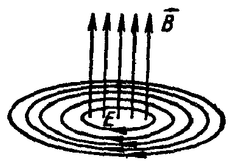
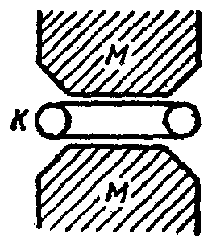

---
{
  "schema": "ld-s10y-lesson/page@3",
  "book": "9p",
  "page": 314,
  "printed_page": 305,
  "source": {
    "pdf": "9p 苏联中学课本 物理 九年级.pdf",
    "pdf_sha256": "df0ea9c3417b7ba0166872b33a8ec81ef20cfb9e15b512a44993174fe92162c0",
    "pdf_page": 314
  },
  "render": {
    "dpi": 300,
    "w": 1504,
    "h": 2289,
    "sha256": "7d0464ecd6849ae67eef2733d30b4c854137cc3bea9e1d8faceacf87ae70e3b4"
  },
  "profile": {
    "id": "soviet-cn",
    "sha256": "c364d68442cfccc9920d3e23932d418c3d7b123cf4a47408e6535dcb19f7104a"
  },
  "notes": [
    "D071 first-author transcription from physical314 page.grid.png, opened once. Independent SOURCE/RAW/SVG review pending.",
    "First 力线 continues313 涡旋. Dot-under emphasis on 涡旋电场, 跟稳恒电场不同 and the closed-path nonzero-work statement is represented by strong markup as an emphasis surrogate, not a claim of printed bold weight.",
    "The actual bold definition starts 单位正电荷 and ends 静止导体中的电动势. Caption289 is parallel to caption288 and shares its printed row.",
    "Figure288 contains nested closed electric-field loops, circulation arrows, five upright magnetic-field arrows and the source E/B labels with their overhead marks. Figure289 contains two hatched electromagnet pole faces each labelled M, and the ring vacuum chamber K; do not substitute N/S for printed M.",
    "Both figures precede128, but their unique prose references occur in127a. Source ownership must follow those references, not the nearest heading.",
    "Actual128 heading is the observed right boundary of127a only;128 continues beyond this page, despite its last paragraph being locally closed. No whole127a/128 approval.",
    "No exercise or footnote is printed. Low full stops are ASCII dots; footer305 is slanted/heavy. Edge blemishes are not text."
  ],
  "errata": [],
  "printed_lines": 20,
  "figures": [
    {
      "id": "fig-288",
      "label": "图 288",
      "box": [
        399,
        680,
        359,
        249
      ]
    },
    {
      "id": "fig-289",
      "label": "图 289",
      "box": [
        912,
        655,
        239,
        282
      ]
    }
  ],
  "provenance": {
    "cap": "1",
    "normalized": true
  }
}
---

<!-- p cont -->
力线那样的闭合线. 这就是所谓的**涡旋电场**（图288）. 它的
方向与感生电流的方向一致. **跟稳恒电场不同**，**在闭合电路**
**上涡旋电场的功不等于零**. 原来，当电荷沿着闭合的电力线
移动时（图288），在路径的所有小段上的功都具有相同的符
号，因为力和位移的方向是一致的. **单位正电荷在闭合电路**
**上移动一周涡旋电场所做的功，是静止导体中的电动势**.

<!-- fig 图 288 box 399,680,359,249 -->

<!-- fig 图 289 box 912,655,239,282 -->

<!-- cap 图 288 -->
图　288

<!-- cap 图 289 samerow -->
图　289

<!-- p -->
强电磁铁的磁场迅速变化时产生很强的涡旋电场，用它
可使电子加速到接近光的速度. 根据这个原理制成了加速电
子的装置——电子加速器. 电子加速器中的电流直接产生在
电磁铁$M$的缝隙里的环状真空室$K$中（图289）.

<!-- h3 -->
**128. 运动导体中的感生电动势**

<!-- p -->
如果导体在不随时间改变的磁场中运动，则导体中的感
生电动势不是由涡旋电场，而是由另外的原因产生的.

<!-- p -->
当导体运动时，它的自由电子也随着它一起运动. 因此，
磁场对电荷作用以洛仑兹力. 它使导体内部的电荷移动. 因
此，感生电动势具有“磁性起源”.

<!-- p -->
地球上的很多发电站，正是洛仑兹力使运动导体中的电
子移动.

<!-- foot -->
• *305* •
