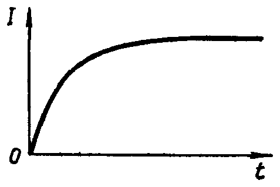
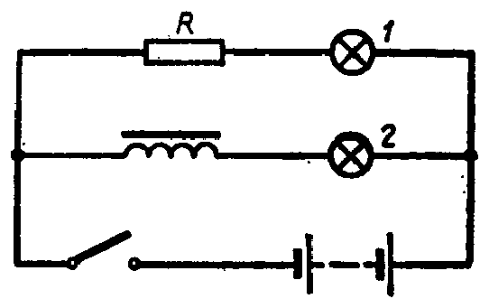

---
{
  "schema": "ld-s10y-lesson/page@3",
  "book": "9p",
  "page": 317,
  "printed_page": 308,
  "source": {
    "pdf": "9p 苏联中学课本 物理 九年级.pdf",
    "pdf_sha256": "df0ea9c3417b7ba0166872b33a8ec81ef20cfb9e15b512a44993174fe92162c0",
    "pdf_page": 317
  },
  "render": {
    "dpi": 300,
    "w": 1504,
    "h": 2289,
    "sha256": "e7f422c13c308a4a0bc7e8b70cc14f39e7bdfc0bf54f15dd4898aeb1be51ee2f"
  },
  "profile": {
    "id": "soviet-cn",
    "sha256": "c364d68442cfccc9920d3e23932d418c3d7b123cf4a47408e6535dcb19f7104a"
  },
  "notes": [
    "D075 first-author transcription from physical317 page.grid.png, opened once. Incoming 叫做自感 continues316 open 这种现象.",
    "The complete printed sentence 变化的磁场在通电导体本身上感生有电动势 is bold across two rows. No dotted emphasis or scientific correction is substituted.",
    "Two separate original figures share one caption row:292 current-versus-time rise with I/O/t axes, and293 parallel resistor-plus-lamp1 and iron-core-coil-plus-lamp2 branches, open switch and two cells. Captions remain one printed row through samerow on293.",
    "Outgoing final paragraph ends at 结 toward318 and refers to294 on the following page. No figure294 invented here and no whole129 approval. Printed low full stops are ASCII dots; footer308 is heavy."
  ],
  "errata": [],
  "printed_lines": 21,
  "figures": [
    {
      "id": "fig-292",
      "label": "图 292",
      "box": [
        174,
        1035,
        453,
        295
      ]
    },
    {
      "id": "fig-293",
      "label": "图 293",
      "box": [
        793,
        1025,
        518,
        317
      ]
    }
  ],
  "provenance": {
    "cap": "1",
    "normalized": true
  }
}
---

<!-- p cont -->
叫做自感. 自感时，导体回路起着双重作用：通过引起感应的
电流；在其中产生感生电动势. **变化的磁场在通电导体本身**
**上感生有电动势**.

<!-- p -->
根据楞次定律，在电流增大的时刻，涡旋电场强度的方向
跟电流方向相反. 因此，在这个时刻，自感阻碍了电流的增
大. 相反的，在电流减小的时刻，自感维持这个电流.

<!-- p -->
这就导致当含有恒定电动势的电路闭合时，电流不能立
刻达到一定的数值，而要经过一段时间才能达到（图292）. 另
一方面，当切断电源电动势时，在各个分支电路中电流不是瞬
时消失的. 同时，当断开电路时，产生的自感电动势可以超过
电源的电动势，因为电流和它的磁场的变化很快.

<!-- fig 图 292 box 174,1035,453,295 -->

<!-- fig 图 293 box 793,1025,518,317 -->

<!-- cap 图 292 -->
图　292

<!-- cap 图 293 samerow -->
图　293

<!-- p -->
可以用实验观察自感现象. 把两只相同的灯泡并联在一
起，如图293所示. 其中一只灯泡通过电阻接到电源上，而第
二只灯泡与带铁芯的线圈串联后接到电源上. 闭合电键时，第
一只灯泡实际上立刻就亮了，而第二只灯泡要推迟一些时候
才正常发亮. 在这只灯泡的电路中自感电动势很大，从而电
流不能立刻达到自己的最大值.

<!-- p open -->
可以观察断路自感电动势作用的电路，如图294所示. 打
开电键$K$时，在线圈中产生自感电动势，维持原有的电流. 结

<!-- foot -->
• **308** •
