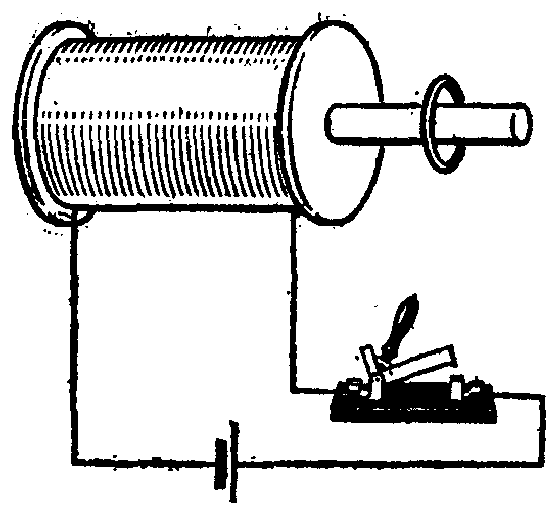

---
{
  "schema": "ld-s10y-lesson/page@3",
  "book": "9p",
  "page": 323,
  "printed_page": 314,
  "source": {
    "pdf": "9p 苏联中学课本 物理 九年级.pdf",
    "pdf_sha256": "df0ea9c3417b7ba0166872b33a8ec81ef20cfb9e15b512a44993174fe92162c0",
    "pdf_page": 323
  },
  "render": {
    "dpi": 300,
    "w": 1504,
    "h": 2289,
    "sha256": "b896a0bc673f2024849095481704f74266193b369ae9117a3ba433731ddd35dc"
  },
  "profile": {
    "id": "soviet-cn",
    "sha256": "c364d68442cfccc9920d3e23932d418c3d7b123cf4a47408e6535dcb19f7104a"
  },
  "notes": [
    "D084 FIRST author candidate. Physical323 page.grid.png opened once, separately from322; every printed text row is transcribed from that source.",
    "The first three printed rows continue and close example2 from322. The source prints S with a lowered n in both the initial-flux expression and charge numerator; S_n is retained without substituting a physically inferred nS. Low full stops and equation punctuation are preserved as ASCII dots.",
    "练习16 begins on this page. Printed exercise numbers1 through10 are retained as a new exercise group, not confused with the preceding example numbers. Exercise10 is open at the final word fragment 磁通量变; no continuation or whole exercise-set/course completion is invented.",
    "Figure297 coarse box is selected from source pixels only: complete wound cylindrical coil, protruding core, surrounding metal ring, both lower connecting wires, battery plates and knife-switch assembly. The printed caption shares exercise8's second row. Independent source/raw/SVG review remains pending.",
    "No footnote or new numbered-unit title is printed. Footer314 is heavy/slanted. Edge scan marks are not printed content; no counting override is applied to the first candidate.",
    "First native finalize failure retained in D084 scratch:29 counted versus28 transcribed. Native band diagnostic identifies the extra band at y2159..2173 as bottom-edge scan marks visible in the once-opened source grid. An80px left/right counting-only margin removes it; the inspected x0..79 and x1424..1503 strips contain no actual printed text or figure elements. All blocks and snapped figure geometry remain unchanged; source PNG and crop pixels are not altered."
  ],
  "errata": [],
  "counting": {
    "edge_margin_px": 80,
    "reason": "D084 once-opened source-grid pixels confirm no printed content in x0..79 or x1424..1503. Native first-failure band y2159..2173 is bottom scan-edge noise, not a missing text row. Native diagnostic changes29 to28 bands with80px; only the counting copy is trimmed."
  },
  "printed_lines": 28,
  "figures": [
    {
      "id": "fig-297",
      "label": "图 297",
      "box": [
        763,
        1152,
        534,
        491
      ]
    }
  ],
  "provenance": {
    "cap": "1",
    "normalized": true
  }
}
---

<!-- ex 2 cont -->
这里$\Phi_0=BS_n$——开始时的磁通量，而$\Phi=0$——最后的磁
通量. 因此，
$q=\frac{BS_n}{R}$.

<!-- exhead -->
练　习　16

<!-- ex 1 -->
1. 电键（图279所示的电路中）刚刚合上. 如果从上往下看，下面
线圈中的电流是逆时针方向的. 当上面的线圈静止不动时，其中的电
流是什么方向？

<!-- ex 2 -->
2. 磁铁（图280）从线圈中拔出，试求线圈中感生电流的方向.

<!-- ex 3 -->
3. 导体回路移到图282中虚线所示的位置上. 试求磁场对回路的
作用力的方向.

<!-- ex 4 -->
4. 把磁铁移近闭合的环（图284），试求环中感生电流的方向.

<!-- ex 5 -->
5. 导体$OO'$中的电流减小（图296）. 试求在静止回路$ABCD$中感
生电流的方向，并求回路每一边所受
的力的方向.

<!-- ex 6 -->
6. 金属环可以沿着线圈的铁芯
自由地运动（图297）. 线圈接在直流
电路中. 当接通和断开电路时将发生
什么现象？

<!-- ex 7 -->
7. 试说明为什么发电机转子中
的电流越大，转子旋转需要做的功越
多？

<!-- ex 8 -->
8. 线圈中的电流随时间正比地
增大. 在跟它有电磁感应的另一个线
圈中，感生电流与时间的关系有什么特性？

<!-- fig 图 297 box 763,1152,534,491 -->

<!-- cap 图 297 samerow -->
图　297

<!-- ex 9 -->
9. 在哪种情况下磁电式仪器指针的振动衰减得快：仪器的接线柱
短接在一起时还是断开时.

<!-- ex 10 open -->
10. 在2秒钟内，通过电阻为$3\times10^{-2}$欧姆的导体回路的磁通量变

<!-- foot -->
• *314* •
