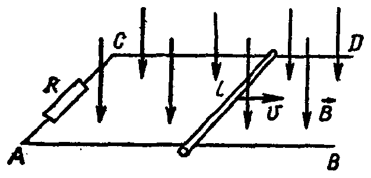

---
{
  "schema": "ld-s10y-lesson/page@3",
  "book": "9p",
  "page": 324,
  "printed_page": 315,
  "source": {
    "pdf": "9p 苏联中学课本 物理 九年级.pdf",
    "pdf_sha256": "df0ea9c3417b7ba0166872b33a8ec81ef20cfb9e15b512a44993174fe92162c0",
    "pdf_page": 324
  },
  "render": {
    "dpi": 300,
    "w": 1504,
    "h": 2289,
    "sha256": "630ea4a1dcdd1ca29728847b4ffef9e01536fffd8bf4bcb004bce9f695d35953"
  },
  "profile": {
    "id": "soviet-cn",
    "sha256": "c364d68442cfccc9920d3e23932d418c3d7b123cf4a47408e6535dcb19f7104a"
  },
  "notes": [
    "SOURCE AUTHOR candidate only. Actual opens1-2: frozen original324 then grid324, once each. Footer315 read from pixels; no old pixels.",
    "First two printed rows are ex10 cont from the supplied323 text ending 磁通量变. Do not repeat its number or infer another condition. Exercises11-13 are closed questions on this page.",
    "Thirteen observed text rows including caption and footer. Fig298 is one whole rough source object; caption is a separate printed row, not samerow.",
    "Fig298 is explicitly referenced by exercise12 and owner-ex12 binds it. Preserve the uneven source rails, slanted resistor/rod, endpoints, field arrows and labels; no redraw, geometric correction or answer annotation.",
    "Printed R much-greater-than r in exercise13 is represented as R\\gg r, without changing the relation or deriving any physical answer. No errata, counting override, figure_crops or SOURCE selfapproval."
  ],
  "errata": [],
  "counting": {
    "edge_margin_px": 100,
    "reason": "Independent SOURCE review identified the extra post-footer band as lower-corner scan dirt, with no omitted printed text; counting-only edge mask preserves all source pixels and rows."
  },
  "printed_lines": 13,
  "figures": [
    {
      "id": "fig-298",
      "label": "图 298",
      "box": [
        498,
        731,
        601,
        277
      ]
    }
  ],
  "provenance": {
    "cap": "1",
    "normalized": true
  }
}
---

<!-- ex 10 cont -->
化了 $1.2\times10^{-2}$ 韦伯. 如果磁通量的变化是均匀的，则通过导体的电流
是多大？

<!-- ex 11 -->
11. 飞机以 900 千米/小时的速度水平地飞行. 如果地磁场磁感应
强度的竖直分量为 $5\times10^{-5}$ 特斯拉，而机翼的长度为 12 米，试求飞机机
翼两端之间的电势差.

<!-- ex 12 -->
12. 长为 $l$ 的导体，在匀强磁场中，可以无摩擦地沿着由电阻 $R$ 连
接的框架 $AB$ 和 $CD$ 移动(图 298). 磁感应强度 $\vec{B}$ 垂直于平面 $ABCD$.
为了使导体以速度 $v$ 匀速运动，必须对导体施以怎样的力 $\vec{F}$？

<!-- fig 图 298 box 498,731,601,277 owner-ex 12 -->

<!-- cap 图 298 -->
图　298

<!-- ex 13 -->
13. 在自感为 0.15 亨利、电阻很小的线圈中通有电流 4 安培. 电
阻 $R\gg r$ 跟线圈并联. 在很快地切断电源之后，在线圈和电阻上各放出
多少热量？

<!-- foot -->
• 315 •
