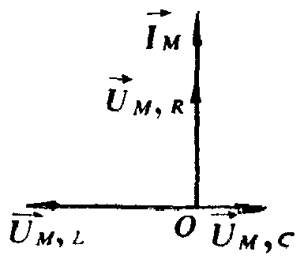
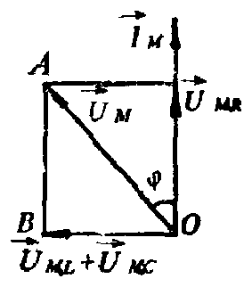

---
{
  "schema": "ld-s10y-lesson/page@3",
  "book": "10p",
  "page": 72,
  "printed_page": 62,
  "source": {
    "pdf": "10p 苏联中学课本 物理 十年级 .pdf",
    "pdf_sha256": "7190041b66182e5f6c5a4ef7ae0b04ee3f1afa0df1f5b3ff6317b2c2d1cb8f40",
    "pdf_page": 72
  },
  "render": {
    "dpi": 300,
    "w": 1536,
    "h": 2337,
    "sha256": "4708786275f289ee6bfd43e76db194d67b25e300b9b11a72b330dfc7e839f26d"
  },
  "notes": [
    "FIRST visual author candidate only; no independent source approval.",
    "Amplitude subscripts use Cyrillic м as an author reading of the italic printed glyph; independent typography review is pending.",
    "Vector arrows are retained where visible. The beginning-of-line U_м,R in the second paragraph and U_м,L in the left-turn sentence have no visible overhead arrow; none is silently added.",
    "Captions 图45 and 图46 occupy the same physical row; the second caption carries samerow.",
    "Final unnumbered equation has no terminal punctuation on this page; its paragraph continues onto the next physical page. No erratum is asserted."
  ],
  "errata": [],
  "profile": {
    "id": "soviet-cn",
    "sha256": "54c02ea7d234571bd2d87c14289640701d1aa7ada4c3aed67403cec26680cddc"
  },
  "printed_lines": 21,
  "figures": [
    {
      "id": "fig-45",
      "label": "图 45",
      "box": [
        277,
        589,
        361,
        309
      ]
    },
    {
      "id": "fig-46",
      "label": "图 46",
      "box": [
        884,
        599,
        259,
        298
      ]
    }
  ],
  "provenance": {
    "cap": "1",
    "normalized": true
  }
}
---

<!-- p -->
图43所示的电路中的电振荡的矢量图使我们能得到在这段电路
中电流强度的振幅和电压的振幅之间的相互关系（2.34）.

<!-- p -->
因为在电路的所有各部分上电流强度都是相同的，那么，从电流强
度矢量$\vec{I}_{м}$开始作矢量图是很方便的. 我们以竖直向上的箭头表示电
流矢量（图45）. 纯电阻上的电压相位和电流强度相位一致，所以矢量
$U_{м,R}$在方向上应和矢量$\vec{I}_{м}$一致，它的模$U_{м,R}=I_{м}R$.

<!-- fig 图 45 box 277,589,361,309 -->

<!-- cap 图 45 -->
图45

<!-- fig 图 46 box 884,599,259,298 -->

<!-- cap 图 46 samerow -->
图46

<!-- p -->
**感抗**上的电压振荡比电流强度振荡超前$\frac{\pi}{2}$，因而相应的矢量$\vec{U}_{м,L}$
应该相对于矢量$\vec{I}_{м}$转过$\frac{\pi}{2}$，它的模$U_{м,L}=I_{м}\omega L$. 如果认为矢量沿逆
时针方向转动对应于正的相位差，则应该把矢量$U_{м,L}$向左转动（当然，
也可以反过来）.

<!-- p -->
电容器上的电压矢量$\vec{U}_{м,C}$相位比矢量$\vec{I}_{м}$滞后$\frac{\pi}{2}$，因此，电压矢量
$\vec{U}_{м,C}$相对于矢量$\vec{I}_{м}$向右转$\frac{\pi}{2}$，它的模$U_{м,C}=I_{м}\frac{1}{\omega C}$.

<!-- p -->
为了求出总电压矢量$\vec{U}_{м}$，应该把$\vec{U}_{м,R}$、$\vec{U}_{м,L}$和$\vec{U}_{м,C}$三个矢量相
加. 先把两个矢量$\vec{U}_{м,L}$和$\vec{U}_{м,C}$相加比较方便（图46），这个合矢量的
模等于$I_{м}\left(\omega L-\frac{1}{\omega C}\right)$，如果$\omega L>\frac{1}{\omega C}$，正是图中所表示的情况. 再把
矢量$\vec{U}_{м,L}+\vec{U}_{м,C}$与矢量$\vec{U}_{м,R}$相加. 我们就得到表示线路中电压振荡
的矢量$\vec{U}_{м}$.

<!-- p open -->
根据勾股定理（从三角形$AOB$）
$U_{м}^2=U_{м,R}^2+(U_{м,L}-U_{м,C})^2=I_{м}^2R^2+I_{м}^2\left(\omega L-\frac{1}{\omega C}\right)^2$

<!-- foot -->
• 62 •
