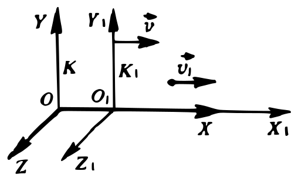

# **98. 速度合成的相对论定律**

速度合成的新定律是符合于空间和时间的相对论新概念的. 很明显，速度合成的经典定律不可能是正确的，因为它与真空中光速是恒量的论点相矛盾.

如果火车以速度 $v$ 运行，并且在车厢中在火车运动的方向上有一光波传播着，则光波相对于地球的速度应当仍然还是 $c$，**而不是** $v+c$. 速度合成的新定律也应该导出所要求的结果.

我们写出（不加证明）个别情况下的速度合成定律：*当物**体沿参考系 $K_1$ 的轴运动，而参考系 $K_1$ 又相对于参考系 $K$ 以**速度 $v$ 运动，并且，在运动过程中坐标轴 $X$ 与 $X_1$ 始终是重合**的，而坐标轴 $Y$ 和 $Y_1$，$Z$ 和 $Z_1$ 始**终是保持平行的（图 226）.*

我们用 $v_1$ 表示*物体相对于**$K_1$ 的速度*，用 $v_2$ 表示*此物体相**对于 $K$ 的速度*. 这时根据速度合成的相对论定律$v_2=\frac{v_1+v}{1+\frac{v_1v}{c^2}}$　（8.6）

*图 226*

如果 $v\ll c$，$v_1\ll c$，则项 $\frac{v_1v}{c^2}$ 在分母中可以忽略不计，我们得出的不是(8.6)式，而是速度合成的经典定律：$v_2=v_1+v$

当 $v_1=c$ 时，速度 $v_2$ 也等于 $c$，正如相对论第二假设要求的那样，确实是，$v_2=\frac{c+v}{1+\frac{cv}{c^2}}=c\frac{c+v}{c+v}=c$

速度合成的相对论定律的突出性质是，在速度 $v_1$ 和 $v$ 为任何值时(当然不能大于 $c$)合速度 $v_2$ 不超过 $c$，在极限情况下，当 $v_1=v=c$ 时，可得$v_2=\frac{2c}{2}=c$

速度 $v>c$ 是不可能的. 当 $v>c$ 时，公式(8.1)和(8.2)就失去意义，因为时间和长度变为虚数了.

**光速是自然界中传递相互作用的最大可能速度.**
