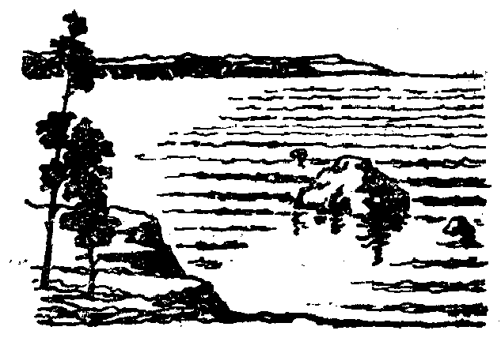

---
{
  "schema": "ld-s10y-lesson/page@3",
  "book": "10p",
  "page": 135,
  "printed_page": 125,
  "source": {
    "pdf": "10p 苏联中学课本 物理 十年级 .pdf",
    "pdf_sha256": "7190041b66182e5f6c5a4ef7ae0b04ee3f1afa0df1f5b3ff6317b2c2d1cb8f40",
    "pdf_page": 135
  },
  "render": {
    "dpi": 300,
    "w": 1536,
    "h": 2337,
    "sha256": "f30da3684d0762d95c2478bd1aaa6c98b7c5662dd5a5910cf7ea9777f0453611"
  },
  "profile": {
    "id": "soviet-cn",
    "sha256": "54c02ea7d234571bd2d87c14289640701d1aa7ada4c3aed67403cec26680cddc"
  },
  "notes": [
    "D805 首次源文作者转写；仅原页作者/native 状态，待独立 SOURCE/RAW 审查，不是 N49 内容批准。",
    "图96与绕图段落为同一印刷页面；图题与“波仍旧能传播；好象这石”一行同排。",
    "保留原文“好象”“树枝条”“环形波”等用语，不作现代改写或科学修正。",
    "页尾“一个振动的”承接物理136页；N49 在后续独立 t14 标题前闭合，不能用 N50 标题替代边界。"
  ],
  "errata": [],
  "printed_lines": 25,
  "figures": [
    {
      "id": "fig-96",
      "label": "图 96",
      "box": [
        711,
        504,
        609,
        404
      ]
    }
  ],
  "provenance": {
    "cap": "1",
    "normalized": true
  }
}
---

<!-- h3 -->
49. 波的衍射

<!-- p -->
在第47节中研究波的反射时，我们认为反射面是非常大
的。但经常的情况是波在自己行进的路程上会遇到不大的（与
波长相比）障碍。波的行为基本上由波长与障碍物大小的关
系来决定。

<!-- p open -->
波能绕过障碍物，如
海浪能自由地迂回过突出
于水上的石头，只要这石
头的大小小于波长或与波
长差不多。在石头后面，
波仍旧能传播；好象这石

<!-- fig 图 96 box 711,504,609,404 -->

<!-- cap 图 96 samerow -->
图 96

<!-- p cont -->
头根本不存在似的（图96中的小石块）。与此相同，扔到池塘
里的石头，激起的波也一样能绕过露出水面的树枝条。只有
大小大于波长的障碍物（图96中的大石头）才能产生自己的
影子：波不能到达它的后面。

<!-- p -->
声波也具有穿过障碍物的能力。当你们还看不到汽车时，
就听到房角后汽车的喇叭声；在森林中，树木挡住了你们的同
伴，为了不把他们丢失，你们就喊叫。声波与光波不同，它能
自由地绕过树干，把你们的声音传给你们的同伴们。

<!-- p -->
**波偏离直线绕过障碍物传播的现象，称为衍射。**衍射和
干涉一样是任何波动过程都具有的。

<!-- p open -->
如果在波的路程上放一个屏，屏上有小于波长的窄缝，就
可以很直观地研究水波的衍射了（图97）。可以明显地看到，
在屏后传播的是环形波，就好象在屏的孔中放了一个振动的

<!-- foot -->
125
