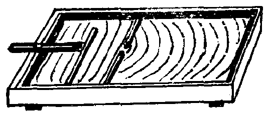
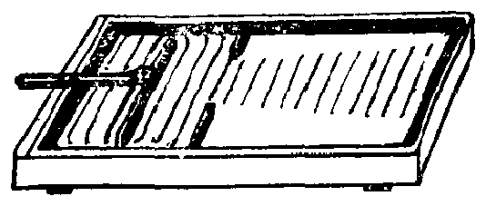

---
{
  "schema": "ld-s10y-lesson/page@3",
  "book": "10p",
  "page": 136,
  "printed_page": 126,
  "source": {
    "pdf": "10p 苏联中学课本 物理 十年级 .pdf",
    "pdf_sha256": "7190041b66182e5f6c5a4ef7ae0b04ee3f1afa0df1f5b3ff6317b2c2d1cb8f40",
    "pdf_page": 136
  },
  "render": {
    "dpi": 300,
    "w": 1536,
    "h": 2337,
    "sha256": "e5cdbd0e59a07966eacc27d3f37b50ee15d3c3fdd7ee97442d9ef0e8d86d047c"
  },
  "profile": {
    "id": "soviet-cn",
    "sha256": "54c02ea7d234571bd2d87c14289640701d1aa7ada4c3aed67403cec26680cddc"
  },
  "notes": [
    "D805 首次源文作者转写；待独立 SOURCE/RAW 审查，不是 N49 批准。",
    "页首图97、图98为两幅独立原图，两个图题位于同一印刷行。",
    "正文“物体——波源一样”承接物理135页末句；保留“确应如此”“菲涅耳”等原文。",
    "问题1至5属于 N49；问题4印刷两行。是否有后续问题由物理137实际源文确认，不以页边界截断。"
  ],
  "errata": [],
  "printed_lines": 22,
  "figures": [
    {
      "id": "fig-97",
      "label": "图 97",
      "box": [
        211,
        258,
        512,
        210
      ]
    },
    {
      "id": "fig-98",
      "label": "图 98",
      "box": [
        778,
        252,
        510,
        203
      ]
    }
  ],
  "provenance": {
    "cap": "1",
    "normalized": true
  }
}
---

<!-- fig 图 97 box 211,258,512,210 -->

<!-- cap 图 97 -->
图 97

<!-- fig 图 98 box 778,252,510,203 -->

<!-- cap 图 98 samerow -->
图 98

<!-- p cont -->
物体——波源一样。按照惠更斯原理也确应如此。窄缝上的
各次波源是如此相互靠近，以至于可以把它们看作是一个点
波源。

<!-- p -->
如果缝的大小比波长大，那么在屏后的波的传播图形就
完全不同了（图98）。波通过缝几乎不改变自己的形状。只
是在两边，才能看到波面的不大的弯曲，由于这种弯曲，波才
能部分地透入屏后的空间。

<!-- p -->
惠更斯原理在其原始表述中，就可使人明白为什么发生
衍射。媒质各部分产生的次波穿过位于波的传播路程上的障
碍的边缘。但是从上述惠更斯原理出发还不能说明衍射现象
的一切细节。惠更斯原理需要进一步精确，十九世纪初法国
学者菲涅耳完成了这一工作。按照菲涅耳的观点，**波阵面在
任何时刻都不只是次波的简单的包络，而是次波干涉的结果。**

<!-- exhead -->
问题

<!-- ex 1 -->
1. 什么波叫做相干波？

<!-- ex 2 -->
2. 什么叫做干涉？

<!-- ex 3 -->
3. 说出干涉图形的最大值与最小值的条件。

<!-- ex 4 -->
4. 干涉图形最小值处的波的相互抵消是否表示波的能
量转变为其它形式的能？

<!-- ex 5 -->
5. 惠更斯原理如何表述？

<!-- foot -->
126
