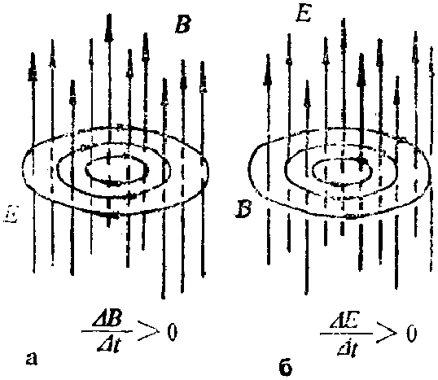

---
{
  "schema": "ld-s10y-lesson/page@3",
  "book": "10p",
  "page": 138,
  "printed_page": 128,
  "source": {
    "pdf": "10p 苏联中学课本 物理 十年级 .pdf",
    "pdf_sha256": "7190041b66182e5f6c5a4ef7ae0b04ee3f1afa0df1f5b3ff6317b2c2d1cb8f40",
    "pdf_page": 138
  },
  "render": {
    "dpi": 300,
    "w": 1536,
    "h": 2337,
    "sha256": "8717af7937370042f454020884fa8672b24462728c26467ad764b39e819e79c9"
  },
  "profile": {
    "id": "soviet-cn",
    "sha256": "54c02ea7d234571bd2d87c14289640701d1aa7ada4c3aed67403cec26680cddc"
  },
  "notes": [
    "D802 first source author only; no independent SOURCE approval.",
    "实际整页显示第五章电磁波、50标题及印刷页128；末段在本页止于产生电，保留open。",
    "图99为一张含两个小图的原图；第二标号实际为西里尔б，第一同序标号а按该印刷序列记录，不用拉丁别名替换。",
    "图99图题与左栏正文末行同排，cap声明samerow。"
  ],
  "errata": [],
  "figure_crops": {
    "fig-99": {
      "padding_px": 4,
      "reason": "D809 affected crop recovery: widened source-ink box retains the original left E label; 4px crop-only padding avoids adjacent left-column prose seen on the unchanged source138 raster. No source pixels or body text changed."
    }
  },
  "printed_lines": 21,
  "figures": [
    {
      "id": "fig-99",
      "label": "图 99",
      "box": [
        759,
        996,
        530,
        459
      ]
    }
  ],
  "provenance": {
    "cap": "1",
    "normalized": true
  }
}
---

<!-- h1 -->
第五章 电磁波

<!-- h3 -->
50. 交变电场和交变磁场间的联系

<!-- p -->
在学习电振荡时，我们应用了九年级物理课程中讲到的
电动力学各定律。而电磁波又是另一回事。电磁波的存在之
所以可能，仅仅是由于电磁场还具有一个重要的特性；这个特
性是麦克斯韦发现的。关于这个性质到目前为止我们尚未讲
到过。

<!-- p -->
我们已经知道，麦克斯韦
看到在电磁感应现象中交变磁
场产生涡旋电场。当磁感应强
度$\vec{B}$随时间变化时产生了电
场，此电场的电力线包围着磁
力线（图99а）。磁感应强度变
化得越快，电场强度就越大。

<!-- fig 图 99 box 759,996,530,459 -->

<!-- cap 图 99 samerow -->
图99

<!-- p -->
根据楞次定律，在磁感应强度增大时（$\frac{\Delta B}{\Delta t}>0$），电场强度
$\vec{E}$的方向与矢量$\vec{B}$的方向成左螺旋。就是说，当沿电力线方
向转动左螺旋的螺纹时，螺旋的旋进方向与磁感应强度的方
向一致。

<!-- p open -->
麦克斯韦在揭示电磁场的基本性质方面又迈出了一步，
也是最后的一步，他提出一个问题：如果交变磁场能产生电

<!-- foot -->
128
