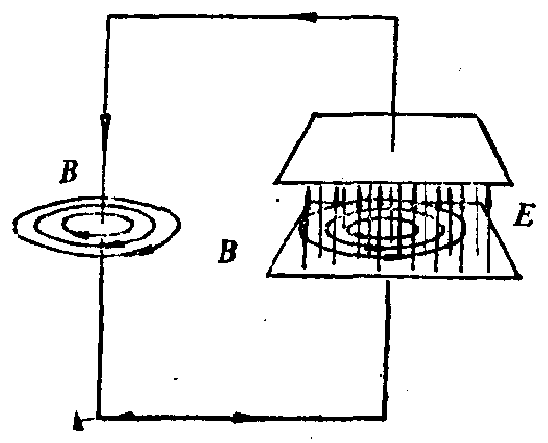

---
{
  "schema": "ld-s10y-lesson/page@3",
  "book": "10p",
  "page": 139,
  "printed_page": 129,
  "source": {
    "pdf": "10p 苏联中学课本 物理 十年级 .pdf",
    "pdf_sha256": "7190041b66182e5f6c5a4ef7ae0b04ee3f1afa0df1f5b3ff6317b2c2d1cb8f40",
    "pdf_page": 139
  },
  "render": {
    "dpi": 300,
    "w": 1536,
    "h": 2337,
    "sha256": "f5865148b01722bc3310ee698a536cfada71d0ed8cdafb125a02bae9d3613269"
  },
  "profile": {
    "id": "soviet-cn",
    "sha256": "54c02ea7d234571bd2d87c14289640701d1aa7ada4c3aed67403cec26680cddc"
  },
  "notes": [
    "D802 first source author only; no independent SOURCE approval.",
    "本页首块场字直接承接p0138末段产生电；50课最后一句为交变磁场。",
    "实际标题51. 电磁场位于本页下部；本页只含51首段，不是完整N51来源或课程。",
    "为完整页级行数对账保留51标题及首段，均未获SOURCE审查批准，禁止将其计为完整N51。",
    "图100归本页50课正文；其图题与左栏麦克斯韦假说的所在印刷行同排。",
    "图99б引用使用实际可辨西里尔б，不用拉丁别名替换。"
  ],
  "errata": [],
  "printed_lines": 24,
  "figures": [
    {
      "id": "fig-100",
      "label": "图 100",
      "box": [
        811,
        875,
        524,
        419
      ]
    }
  ],
  "provenance": {
    "cap": "1",
    "normalized": true
  }
}
---

<!-- p cont -->
场，那么它的相反过程，即交变电场也同样地产生磁场的过程
在自然界里就不存在吗？由于确信自然界的统一性，确信自
然界规律的内部严整性和谐调性而产生的这个设想，构成了
麦克斯韦假说的基础。

<!-- p -->
麦克斯韦假设，在自然界中确实会发生那种过程：在一切
情况下，**当电场随时间变化时，它就产生磁场。**这个磁场的磁
力线包围着电场的电力线（图99б）。与电磁感应现象不同的
是，当电场强度增大时（$\frac{\Delta E}{\Delta t}>0$），磁感应强度$\vec{B}$的方向和矢
量$\vec{E}$的方向构成右螺旋。

<!-- p open -->
根据麦克斯韦假说，例如，在电容器充电时，不仅导体中
的电流产生磁场，而且在电容
器两极板间的空间中变化着的
电场也能产生磁场（图100）。
并且，变化着的电场建立的磁
场与假设在电容器两板间存在
着和导体中相等的电流而建立
的磁场一样。麦克斯韦假说的

<!-- fig 图 100 box 811,875,524,419 -->

<!-- cap 图 100 samerow -->
图100

<!-- p cont -->
正确性已被发现电磁波存在的实验证实。电磁波的存在仅仅
是由于交变的磁场产生交变电场，而交变电场又同样地产生
交变磁场。

<!-- h3 -->
51. 电磁场

<!-- p -->
揭示了电场和磁场间的相互联系之后，它们不是互不相
关地孤立存在的就变成很明白的事了。

<!-- foot -->
129
