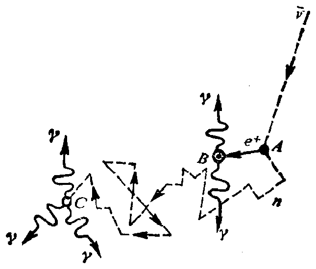

---
{
  "schema": "ld-s10y-lesson/page@3",
  "book": "10p",
  "page": 384,
  "printed_page": 374,
  "source": {
    "pdf": "10p 苏联中学课本 物理 十年级 .pdf",
    "pdf_sha256": "7190041b66182e5f6c5a4ef7ae0b04ee3f1afa0df1f5b3ff6317b2c2d1cb8f40",
    "pdf_page": 384
  },
  "render": {
    "dpi": 300,
    "w": 1536,
    "h": 2337,
    "sha256": "9d9fff58f56e041d5cce1b43242b6951c8d5774360c27ab5806ff1ef72bed006"
  },
  "profile": {
    "id": "soviet-cn",
    "sha256": "54c02ea7d234571bd2d87c14289640701d1aa7ada4c3aed67403cec26680cddc"
  },
  "notes": [
    "SOURCE384 first grid plus one final-row crop; 18 printed rows including caption/footer. Figure277 rough box only; native crop and source approval pending.",
    "Final-row crop visibly reads 并经过极认; retain this observed fragment without conjectural correction or continuation.",
    "HOLD: original glyph script identities, punctuation/spacing codepoints, exact figure geometry and statement emphasis remain independently unapproved."
  ],
  "errata": [],
  "printed_lines": 18,
  "figures": [
    {
      "id": "fig-277",
      "label": "图 277",
      "box": [
        424,
        252,
        621,
        526
      ]
    }
  ],
  "provenance": {
    "cap": "1",
    "normalized": true
  }
}
---

<!-- fig 图 277 box 424,252,621,526 -->

<!-- cap 图 277 -->
图 277

<!-- p cont -->
子(图 277 中 $A$ 点)立即就和一个电子($B$ 点)湮灭，放出2个
$\gamma$ 量子. $\gamma$ 量子引起闪烁物闪光，这个闪光由专门仪器记录
下来. 反应时产生的中子，徘徊了一会儿后被专门加入水中
的镉核俘获($C$ 点)，此后镉核放出一些$\gamma$量子，这就是中子出
现的信号. 根据开始时产生了两个向不同方向飞去的$\gamma$量
子，过了一段不大的时间后又有一些$\gamma$量子产生，证明了反中
微子的存在，它的可信程度只是在元素微粒世界中才是可
能的.

<!-- p -->
**基本粒子衰变的实质**　在结论中我们注意到，中子和其
它粒子的衰变是基本粒子世界中的转化，而不是复杂系统分
解为各个组成部分.

<!-- p open -->
**派生的粒子对原始粒子的关系完全不像打碎的瓦罐的碎**
**片对完整的瓦罐的关系.** 例如在中子衰变的情况中，很明显，
因为反中微子只存在于以光速运动的直线运动中，则反中微
子不可能存在于中子内部. 在中子衰变中产生出来的质子和
电子可以构成稳定的系统. 但是这是众所周知的并经过极认

<!-- foot -->
• 374 •
