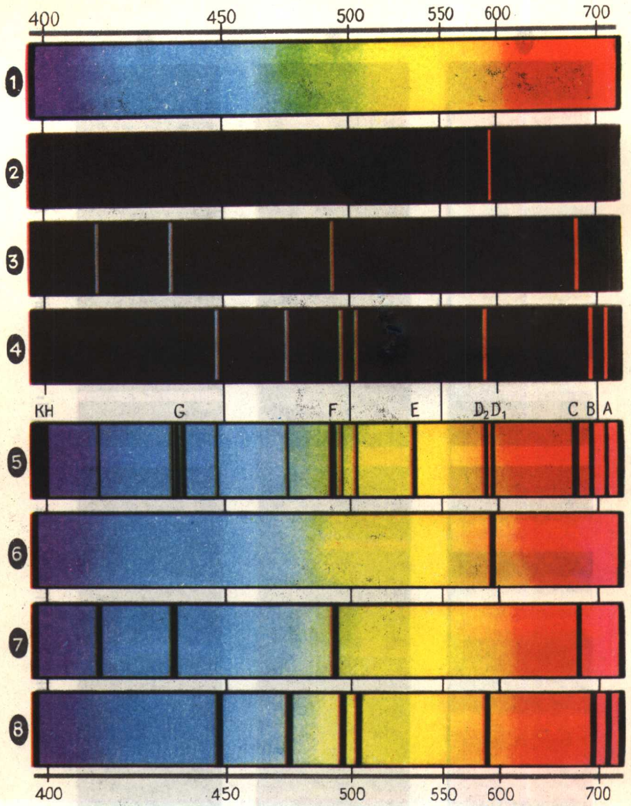

---
{
  "schema": "ld-s10y-lesson/page@3",
  "book": "10p",
  "page": 419,
  "printed_page": null,
  "source": {
    "pdf": "10p 苏联中学课本 物理 十年级 .pdf",
    "pdf_sha256": "7190041b66182e5f6c5a4ef7ae0b04ee3f1afa0df1f5b3ff6317b2c2d1cb8f40",
    "pdf_page": 419
  },
  "render": {
    "dpi": 300,
    "w": 1536,
    "h": 2337,
    "sha256": "42e54332b9df962c356a5a2501d3e1d1d73c2be80a9d5280fed724be19fdee56"
  },
  "profile": {
    "id": "soviet-cn",
    "sha256": "54c02ea7d234571bd2d87c14289640701d1aa7ada4c3aed67403cec26680cddc"
  },
  "notes": [
    "Source authorship only; native prepare is not source/content approval. No printed page number is visibly confirmed.",
    "Keep the printed Roman identity 图 V. The single rough figure box includes rows 1-8, both scales, all chart labels and spectral marks; explanatory caption prose remains outside the figure.",
    "HOLD H1: the exact glyph sequence of the blue page-top stamp is not confidently transcribed. It is not assigned as printed_page or added to textbook prose.",
    "HOLD H2/H3: exact fine-line positions, widths, unresolved multiplicity and line-to-wavelength/letter bindings are not measured or approved. Source colors remain pixel evidence, not theme colors.",
    "HOLD H4/H5: independent source/crop/counting approval and external Roman-V ownership support remain unestablished. No numeric figure ID, ownership or N86 completion is asserted."
  ],
  "errata": [],
  "printed_lines": 2,
  "figures": [
    {
      "id": "tbl-p0419-01",
      "label": "图 V",
      "box": [
        99,
        103,
        1382,
        1770
      ]
    }
  ],
  "provenance": {
    "cap": "1",
    "normalized": true
  }
}
---

<!-- fig 图 V box 99,103,1382,1770 -->

<!-- cap 图 V -->
图 V．发射光谱：1—连续的；2—钠的；3—氢的；4—氦的。
吸收光谱：5—太阳的；6—钠的；7—氢的；8—氦的。
