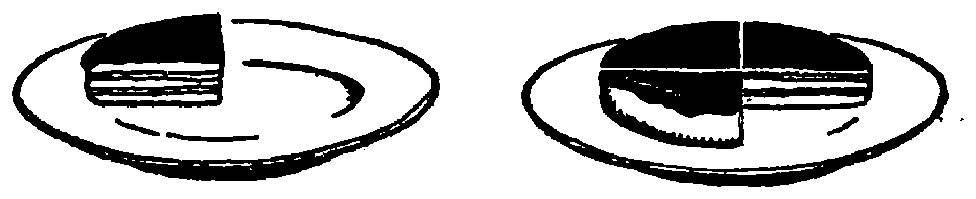

---
{
  "schema": "ld-s10y-lesson/page@3",
  "book": "4m",
  "page": 13,
  "printed_page": 4,
  "notes": [
    "第9至13题完整属于第一单元；其后实际标题2开启第二单元。图1属于第二单元正文，不属于第13题。",
    "第二单元首段跨图1与PDF14延续，保留p open/cont；图1两盘蛋糕整体一框，图题是独立文字行。",
    "页脚两侧装饰点及页边少量痕迹不作为正文。"
  ],
  "errata": [],
  "source": {
    "pdf": "4m 苏联十年制学校教材 数学 四年级.pdf",
    "pdf_sha256": "642b18080aeaedd63a713f8e7e83c179459df1f5a21a93d80841a6c8530600d8",
    "pdf_page": 13
  },
  "render": {
    "dpi": 300,
    "w": 1504,
    "h": 2172,
    "sha256": "7f0825c021e512bc503c248898d90eaace246413062fd7f59fa96087a83a8637"
  },
  "profile": {
    "id": "soviet-cn",
    "sha256": "dad8d974ba16880482f359073263269de8c405ccf8cb17dc4215fad11da44849"
  },
  "printed_lines": 22,
  "figures": [
    {
      "id": "fig-01",
      "label": "图 1",
      "box": [
        236,
        1746,
        952,
        175
      ]
    }
  ],
  "provenance": {
    "cap": "1",
    "normalized": true
  }
}
---

<!-- exhead -->
家庭作业题

<!-- ex 9 -->
9. 用数字写出下列各数：
а) 九百零五个十亿三百零八个百万六百个千七百四十
五；
б) 十个十亿一百个百万七十五个千三；
в) 四个十亿五个千六。

<!-- ex 10 -->
10. 把数字“3”连续写9次，读出所得的这个数。

<!-- ex 11 -->
11. 苏联最高的山峰——共产主义峰高出海平面7495米，胜
利峰比共产主义峰低56米，卡兹别克峰比胜利峰低2406
米，厄尔布鲁士山比卡兹别克峰高609米。厄尔布鲁士
山的高度是多少？厄尔布鲁士山比共产主义峰低多少米？

<!-- ex 12 -->
12. 解方程：
а) $2341+(y+749)=3091$；
б) $8405+(374+x)=8985$。

<!-- ex 13 -->
13. 计算：
а) $(58\,508+498\,115):69$；
б) $(884\,034-94\,683):87$。

<!-- h3 -->
2. 分数的表示法

<!-- p open -->
把一块大蛋糕切成相等的4份（图1）。在一个盘子里放
上1份，而在另一个盘子里放上3份。在第一个盘子里放着

<!-- fig 图 1 box 236,1746,952,175 -->

<!-- cap 图 1 -->
图 1

<!-- foot -->
4
