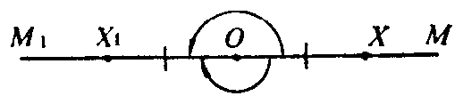

---
{
  "schema": "ld-s10y-lesson/page@3",
  "book": "6-8g",
  "page": 95,
  "printed_page": 85,
  "source": {
    "pdf": "6-8g 苏联十年制学校数学教材 几何 六-八年级.pdf",
    "pdf_sha256": "d06ea093886065380febda597331bb5d48c81303d955161f2f84a7f11c116e5c",
    "pdf_page": 95
  },
  "render": {
    "dpi": 300,
    "w": 1441,
    "h": 2079,
    "sha256": "a7183591240e9539e66989f1662607f3960c56c7c7df338253d4b27f6ceaab8c"
  },
  "profile": {
    "id": "soviet-cn",
    "sha256": "19d56195a3a63cf4be93a7a159e1513d37b9b17d1b92235d8ae3d4e826cc45d0"
  },
  "notes": [
    "FIRST author only; no independent source or human approval. Physical 95 / printed 85.",
    "20. 中心对称 is the literal printed section heading. h2 classification is author inference; the number is not reconciled with prior theorem/unit numbering by invention.",
    "Exercise 240(3) line symbol is FIRST read P; fine symbol identity remains a recorded source-reading candidate without another view.",
    "One final new native-original 1:1 ROI covers two prose rows before 图 113, the whole figure and caption. Faded strokes in 已知射线 / 与射线 OM / 方向 remain source-ink limitations even where literal candidates are recorded.",
    "图 113 labels are M_1 X_1 O X M with three filled points in order X_1 O X and two interval ticks. Upper and smaller lower semicircular strokes have unequal spans. Lower-left curved end is thickened/arrow-like; precise arrowhead/direction remains unresolved. No regularized circle or unprinted angle annotation added.",
    "Bottom paragraph remains p open after 平面上任何一点的. Physical 96 is UNKNOWN and not opened; no invented continuation or closure.",
    "Thin separator above heading, footer dots, top black band, edge traces and specks are retained as observed marks/limitations; no count_exclusions added.",
    "Worker lifetime image use is exactly eight: four grid sole views and four distinct new native-original ROI sole views. No further image loaded."
  ],
  "errata": [],
  "printed_lines": 23,
  "figures": [
    {
      "id": "fig-113",
      "label": "图 113",
      "box": [
        503,
        1598,
        494,
        93
      ]
    }
  ],
  "provenance": {
    "cap": "1",
    "normalized": true
  }
}
---

<!-- ex 240 -->
240. 下面给出的是平面上的一些映射. 说明它们中的任何一
个映射都不是位移.
1）$f_1(A)=B, f_1(B)=A$，平面上其余的点都被映射到
它们自身上（$A\ne B$）.
2）$f_2(O)=O$，平面上的任一点 $X$ 被映射到射线 $OX$ 上
的这样的点 $X_1$，使得 $|OX_1|=k|OX|$（$k$ 是不等于 1 的
任何正数）.
3）平面上任一点 $X$ 的象是从点 $X$ 向直线 $P$ 所引垂线的
垂足.

<!-- ex 241 -->
241. 列举一些这样的图形，使得存在几个将这些图形映射到
它们自身上的旋转.

<!-- h2 -->
20. 中心对称

<!-- p -->
当 $\alpha\ne0^\circ$ 和 $\alpha\ne180^\circ$ 时，存在着两个绕已知中心 $O$、旋转
角为 $\alpha$ 的旋转：一个按顺时针方向旋转，另一个按反时针方向
旋转. 而当 $\alpha=0^\circ$ 时，这样的旋转只有一个，它就是平面上的
恒等映射.

<!-- p -->
我们再来看当 $\alpha=180^\circ$ 时的特殊情况. 这时仅存在着一
条由已知射线 $OM$ 绕原点 $O$ 旋转 $180^\circ$ 而得到的射线，这就是
在直线 $OM$ 上的与射线 $OM$ 方向相反的射线 $OM_1$（图 113）.

<!-- fig 图 113 box 503,1598,494,93 -->

<!-- cap 图 113 -->
图 113

<!-- p open -->
在射线 $OM_1$ 上仅有一个与点 $O$ 的距离为 $|OX|$ 的点 $X_1$. 因
此，在绕中心 $O$ 旋转角为 $180^\circ$ 的旋转下，平面上任何一点的

<!-- foot -->
• 85 •
