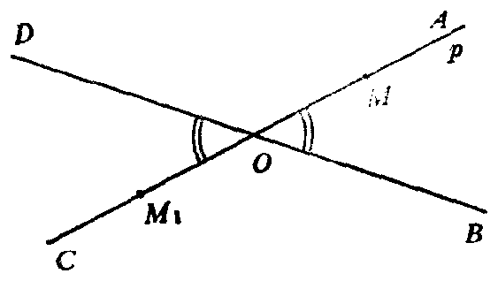

---
{
  "schema": "ld-s10y-lesson/page@3",
  "book": "6-8g",
  "page": 96,
  "printed_page": 86,
  "source": {
    "pdf": "6-8g 苏联十年制学校数学教材 几何 六-八年级.pdf",
    "pdf_sha256": "d06ea093886065380febda597331bb5d48c81303d955161f2f84a7f11c116e5c",
    "pdf_page": 96
  },
  "render": {
    "dpi": 300,
    "w": 1441,
    "h": 2079,
    "sha256": "0fb1ef695b0acb1c02c238b13c9d78de014667f905fec2fa268b1ed52b086186"
  },
  "profile": {
    "id": "soviet-cn",
    "sha256": "19d56195a3a63cf4be93a7a159e1513d37b9b17d1b92235d8ae3d4e826cc45d0"
  },
  "notes": [
    "FIRST grid plus one distinct original 1:1 lower-literal ROI; not source-approved. Incoming p cont uses only parent-author 0095 tail. Printed claim 22 has a solid black vertical marker before its emphasized text. Center-symmetry and proposition phrases have wavy underlining. ROI resolves final relation as congruence and faint upper interior label as M; residual missing fine M strokes/subscript certainty and arc-tip fine ink remain UNKNOWN. Final black square and footer flanking dots are visible. Top black scan-edge stripe and thin left-edge trace remain unclassified scan ink, not excluded."
  ],
  "errata": [],
  "printed_lines": 21,
  "figures": [
    {
      "id": "fig-114",
      "label": "图 114",
      "box": [
        468,
        1245,
        539,
        294
      ]
    }
  ],
  "provenance": {
    "cap": "1",
    "normalized": true
  }
}
---

<!-- p cont -->
象都与旋转方向无关，也就是说，仅存在着一个绕已知中心和
旋转角为 $180^\circ$ 的旋转.

<!-- p -->
从作图看到（看图 113），平面上任一点 $X$ 在上述旋转下
的象是这样的点 $X_1$，使得中心 $O$ 为线段 $XX_1$ 的中点. 正如我
们所知，$X$ 与 $X_1$ 这样的两点叫做关于中心 $O$ 对称的点. 旋转
角为 $180^\circ$ 的旋转叫做中心对称，并用 $Z_O$ 来表示关于中心 $O$
的对称.

<!-- p -->
我们来研究中心对称的性质.

<!-- p -->
22 中心对称是位移.

<!-- p -->
这个结论的正确性可立刻由上面的第 20 条性质得出. 当
证明图形的合同时，我们常利用性质 22. 例如，我们来证明大
家所熟悉的命题：

<!-- p -->
凡对顶角都合同.

<!-- p open -->
图 114 中是两个对顶角 $AOB$ 与 $COD$，我们来研究中心
对称 $Z_O$. 在这个对称下，点 $O$ 被映射到它自身，而射线 $OA$ 与

<!-- fig 图 114 box 468,1245,539,294 -->

<!-- cap 图 114 -->
图 114

<!-- p cont -->
$OB$ 相应地被映射到射线 $OC$ 与 $OD$ 上. 因此，角 $AOB$ 在对
称 $Z_O$ 下的象就是它的对顶角 $COD$. 因为中心对称是位移，也
就是将任一图形映射到与它合同的图形上，所以我们得到：
$\angle AOB\cong\angle COD$. ■

<!-- foot -->
86
