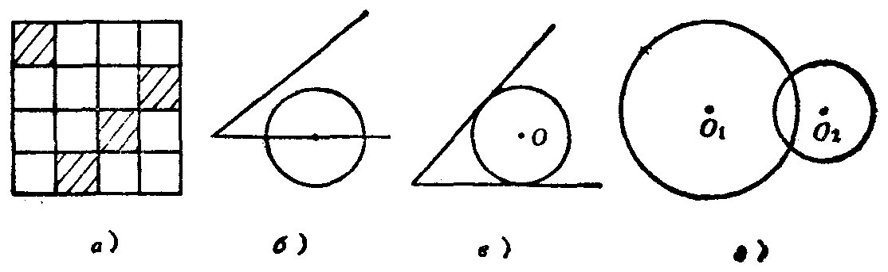

---
{
  "schema": "ld-s10y-lesson/page@3",
  "book": "6-8g",
  "page": 98,
  "printed_page": 88,
  "source": {
    "pdf": "6-8g 苏联十年制学校数学教材 几何 六-八年级.pdf",
    "pdf_sha256": "d06ea093886065380febda597331bb5d48c81303d955161f2f84a7f11c116e5c",
    "pdf_page": 98
  },
  "render": {
    "dpi": 300,
    "w": 1441,
    "h": 2079,
    "sha256": "f9a2ae2fc2d9352183e26ed4b4a28ce65326fd13f2aed063e5b4ea283cf38d08"
  },
  "profile": {
    "id": "soviet-cn",
    "sha256": "19d56195a3a63cf4be93a7a159e1513d37b9b17d1b92235d8ae3d4e826cc45d0"
  },
  "notes": [
    "FIRST grid plus one original 1:1 figure-literal ROI; not source-approved. Exercise 244 continues from own 0097 open fragment. Figure 115 has four panels, a 4x4 square grid with hatched cells r1c1/r2c4/r3c3/r4c2, two angle/circle panels and two overlapping circle outlines labeled O_1/O_2. ROI records every panel and fine stroke; exact hatch multiplicity at cell boundaries, fine third/fourth subletter glyphs and meaning of curve/line-end protrusions remain UNKNOWN. No inferred tangency/equality/transformation. Exercise 245 final math wrap is encoded by cap1 wrap marker. Margin specks and top/left scan-edge ink remain unclassified and not excluded."
  ],
  "errata": [],
  "printed_lines": 20,
  "figures": [
    {
      "id": "fig-115",
      "label": "图 115",
      "box": [
        165,
        1497,
        1090,
        319
      ]
    }
  ],
  "provenance": {
    "cap": "1",
    "normalized": true
  }
}
---

<!-- ex 244 cont -->
对称下的象； 2) 射线 $OC$ 在关于中心 $O$ 对称下的象；
3) 角 $ABC$ 在关于点 $B$ 对称下的象.

<!-- ex 245 -->
245. 1) 在下列情况下，分别求作与已知线段 $AB$ 关于已知
中心 $O$ 对称的线段：а) $O\in(AB)$；б) $O\notin(AB)$. 2) 求作
与已知直线 $AB$ 关于已知中心 $O\notin(AB)$ 对称的直线.
3) 在下列情况下，分别用细斜线表示出以 $AB$ 为边界
的已知半平面在对称 $Z_O$ 下的象：а) $O\in(AB)$；б) $O\notin↵(AB)$.

<!-- ex 246 -->
246. 什么样的图形叫做中心对称图形？举一些中心对称图形
的例子.

<!-- ex 247 -->
247. 1) 线段，直线，射线，圆周，两条相交直线的并集各有无
对称中心？
2) 是否存在具有对称中心的三角形（四边形，五边
形）？
3) 是否存在具有两个以上的对称中心的图形？

<!-- ex 248 -->
248. 图 110 中的哪些图形具有对称中心？

<!-- ex 249 -->
249. 求作分别与图 115 中各图形成中心对称的图形（自己选
取对称中心）.

<!-- fig 图 115 box 165,1497,1090,319 -->

<!-- cap 图 115 -->
图 115

<!-- foot -->
88
