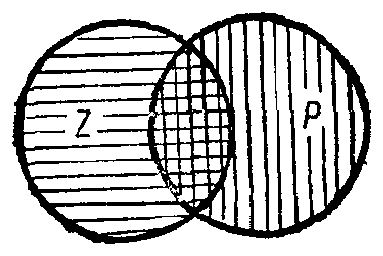

---
{
  "schema": "ld-s10y-lesson/page@3",
  "book": "7a",
  "page": 282,
  "printed_page": 276,
  "notes": [],
  "errata": [],
  "source": {
    "pdf": "7a 苏联十年制学校数学教材 代数 七年级.pdf",
    "pdf_sha256": "8070c333ee46fb0dc650cb32d4d898f605ed308559b6cc430425d908dae6b052",
    "pdf_page": 282
  },
  "render": {
    "dpi": 300,
    "w": 1504,
    "h": 2289,
    "sha256": "3f5926d7fb556479dd99f5ef3b5191d7d5eee27fb59a0bbed28878cb7a6dca2f"
  },
  "profile": {
    "id": "soviet-cn",
    "sha256": "dad8d974ba16880482f359073263269de8c405ccf8cb17dc4215fad11da44849"
  },
  "printed_lines": 28,
  "figures": [
    {
      "id": "fig-62",
      "label": "图 62",
      "box": [
        889,
        1676,
        359,
        232
      ]
    }
  ],
  "provenance": {
    "cap": "1",
    "normalized": true
  }
}
---

<!-- ex 909 cont -->
а) 利用“欧拉圆”表示集合$N$和$Q$之间的包含关系。
б) 在作出的图上，用细线条表示集合$Q$内集合$N$的余
集(或补集)。
举出这个集合里的几个元素。
в) 下面的命题是真命题吗？
任何有理数都是自然数。

<!-- ex 910 -->
910. 设$K$是偶数的集合，而$L$是能被$4$整除的数的集合。
作“欧拉圆”表示集合$K$和$L$的关系。在作出的图上用
细线条表示不能被$4$整除的偶数的集合。下面的命题是
真命题吗？
а) 要使一个数是偶数，只要使它能被$4$整除就够了。
б) 要使一个数是偶数，必须使它能被$4$整除。
в) 要使一个数能被$4$整除，只要使它是偶数就够了。
г) 要使一个数能被$4$整除，必须使它是偶数。

<!-- ex 911 -->
911. 对于能被$6$整除的数的集合$B$和能被$3$整除的数的集
合$C$，作出“欧拉圆”。
下面的命题是真命题吗？
а) 要使一个数能被$6$整除，只要使它能被$3$整除就够了；
б) 要使一个数能被$6$整除，必须使它能被$3$整除。

<!-- ex 912 -->
912. 对于能被$6$整除的数的集合$B$、能被$3$整除的数的集合
$C$和整数集合$Z$，作出“欧拉圆”。

<!-- ex 913 open -->
913. 在图$62$里，表示了整数集合$Z$和正数集合$P$之间的关
系。
а) 图形的哪一部分对应于自
然数(正整数)的集合？
б) 图形的哪一部分对应于正
数但不是整数的集合？

<!-- fig 图 62 box 889,1676,359,232 -->

<!-- cap 图 62 samerow -->
图 62

<!-- foot -->
276
