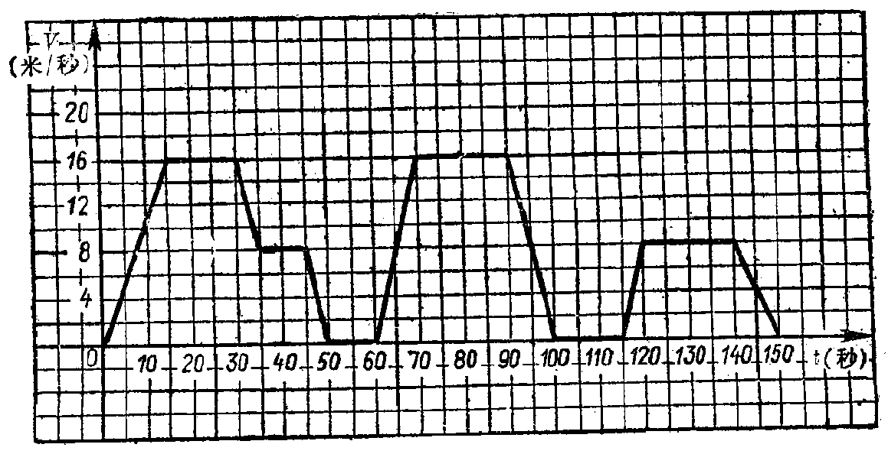

---
{
  "schema": "ld-s10y-lesson/page@3",
  "book": "7a",
  "page": 288,
  "printed_page": 282,
  "lesson_id": "alg7-c4-ex",
  "notes": [
    "首三行是第940题的г)、д)、е)续项，题号由本批已读287页唯一确认。",
    "第942题本页有引句和图65，后续提问续至289页；图内坐标、单位、曲线均由原书图像保留。"
  ],
  "errata": [],
  "source": {
    "pdf": "7a 苏联十年制学校数学教材 代数 七年级.pdf",
    "pdf_sha256": "8070c333ee46fb0dc650cb32d4d898f605ed308559b6cc430425d908dae6b052",
    "pdf_page": 288
  },
  "render": {
    "dpi": 300,
    "w": 1504,
    "h": 2289,
    "sha256": "ed48543bce9d291db6c2625c627532465c1f3293329aeb6815d81c52e3a19a67"
  },
  "profile": {
    "id": "soviet-cn",
    "sha256": "dad8d974ba16880482f359073263269de8c405ccf8cb17dc4215fad11da44849"
  },
  "printed_lines": 15,
  "figures": [
    {
      "id": "fig-65",
      "label": "图 65",
      "box": [
        198,
        1362,
        1135,
        570
      ]
    }
  ],
  "provenance": {
    "cap": "1",
    "normalized": true
  }
}
---

<!-- ex 940 cont -->
г) $(x_2>x_1>0)\Longrightarrow\left(\frac{1}{x_2}>\frac{1}{x_1}\right)$；
д) $(x_2>x_1>0)\Longrightarrow\left(\frac{1}{x_2}<\frac{1}{x_1}\right)$；
е) $(x_2>x_1>0)\Longrightarrow(x_2^2>x_1^2)$。

<!-- ex 941 -->
941. 已知：1) 函数$f$和$g$的定义域都是集合$M$；2) $f$是
增函数；3) $g$是减函数；4) $a\in M,b\in M$。说明下列命
题是否真命题：
а) $(f(a)>f(b))\Longrightarrow(a>b)$；
б) $(g(a)>g(b))\Longrightarrow(a<b)$；
в) $(f(a)<f(b))\Longrightarrow(a<b)$；
г) $(g(a)<g(b))\Longrightarrow(a<b)$；
д) $(a\ne b)\Longrightarrow\left(\frac{f(a)-f(b)}{a-b}>0\right)$；
е) $(a\ne b)\Longrightarrow\left(\frac{g(a)-g(b)}{a-b}<0\right)$。

<!-- ex 942 open -->
942. 在图65里，画出了在路上行驶的小汽车的速度的图象。

<!-- fig 图 65 box 198,1362,1135,570 -->

<!-- cap 图 65 -->
图65

<!-- foot -->
282
