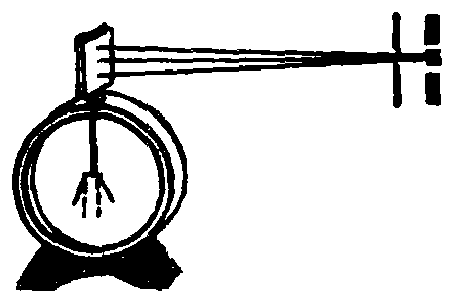
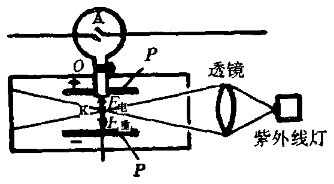

---
{
  "schema": "ld-s10y-lesson/page@3",
  "book": "7p",
  "page": 297,
  "printed_page": 286,
  "source": {
    "pdf": "6-7p 苏联中学课本 物理 六-七年级.pdf",
    "pdf_sha256": "46e2b2e4a92b7c00fab9adfc6a8a9b5340a9519fa90f1b82e79bc1e1432fcbb0",
    "pdf_page": 297
  },
  "render": {
    "dpi": 300,
    "w": 1472,
    "h": 2161,
    "sha256": "edd885fa24caa396937beeabf873d4966be55f6a455ceac2b5b4ecda6f311f52"
  },
  "profile": {
    "id": "soviet-cn",
    "sha256": "dad8d974ba16880482f359073263269de8c405ccf8cb17dc4215fad11da44849"
  },
  "notes": [
    "Physical page 297 only. Lesson 118 starts here; the final paragraph is open at the printed page boundary.",
    "Preserve the source wording 约飞实验 in the apparatus paragraph without editorial correction.",
    "Russian initials are transcribed as Cyrillic А. Ф.; R. is Latin. Mathematical apparatus labels are italic Latin letters; 重 and 电 are printed subscripts.",
    "Captions for figures 253 and 254 share one printed row. Footer bullets are preserved.",
    "Source-author candidate only; no source approval or lesson-completion claim."
  ],
  "errata": [],
  "printed_lines": 20,
  "figures": [
    {
      "id": "fig-253",
      "label": "图 253",
      "box": [
        233,
        1045,
        430,
        279
      ]
    },
    {
      "id": "fig-254",
      "label": "图 254",
      "box": [
        773,
        1026,
        534,
        284
      ]
    }
  ],
  "provenance": {
    "cap": "1",
    "normalized": true
  }
}
---

<!-- h3 -->
**118. 约飞实验与密立根实验　电子**

<!-- p -->
许多实验都证明了，确有带着最小电荷的带电粒子存在.
其中苏联学者 А. Ф. 约飞以及美国学者 R. 密立根各自独立
提出来的实验最具有说服力.

<!-- p -->
我们先来介绍他们的实验中所要用到的一个物理现象.
这个现象就是，在光（特别是紫外线）的作用下，物体所带的负
电荷就会减少. 例如，带负电的锌板（图 253）在紫外线的作
用下就会放电. （紫外线辐射就是那种能使人皮肤变黑的辐
射. 不是只在太阳光里才含有这种辐射，它也可以包含在由
专门的灯泡所发出的光里.）

<!-- fig 图 253 box 233,1045,430,279 -->

<!-- fig 图 254 box 773,1026,534,284 -->

<!-- cap 图 253 -->
图 253

<!-- cap 图 254 samerow -->
图 254

<!-- p -->
图 254 所示的就是约飞实验所用的装置. 在封闭的容器
中装有两块水平放置的金属板 $P$，微小的带电锌粉由箱 $A$ 中
通过孔 $O$ 落入两块金属板的中间. 这些锌粉只能用显微镜才
看得到.

<!-- p open -->
我们假设有一粒锌粉 $K$ 带负电. 在重力 $F_{\text{重}}$ 的作用下开
始下落. 不过，若是下面的那块金属板带上负电而上面的那
块带上正电，它的下落就有可能被阻止. 在两块金属板之间
的电场中，锌粉要受到电场力 $F_{\text{电}}$ 的作用. 这个力的大小与锌

<!-- foot -->
• 286 •
