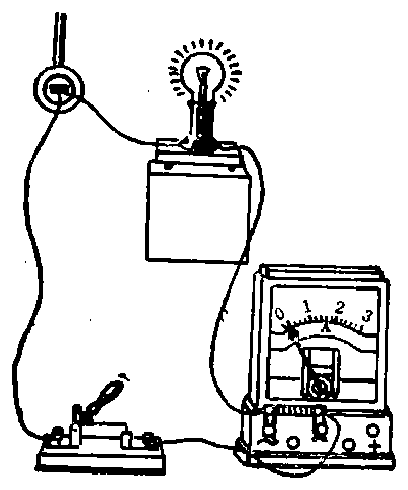

---
{
  "schema": "ld-s10y-lesson/page@3",
  "book": "7p",
  "page": 334,
  "printed_page": 323,
  "source": {
    "pdf": "6-7p 苏联中学课本 物理 六-七年级.pdf",
    "pdf_sha256": "46e2b2e4a92b7c00fab9adfc6a8a9b5340a9519fa90f1b82e79bc1e1432fcbb0",
    "pdf_page": 334
  },
  "render": {
    "dpi": 300,
    "w": 1472,
    "h": 2161,
    "sha256": "3b4d635c18a1ad0b9fef8fe227b04159dc4bc867c88eb5916169e2c9f861544e"
  },
  "profile": {
    "id": "soviet-cn",
    "sha256": "dad8d974ba16880482f359073263269de8c405ccf8cb17dc4215fad11da44849"
  },
  "notes": [
    "AUTHORONLY。完整清单先于候选冻结。继承第133单元及上节身份仅为结构，未核对TOC，未获SOURCE审批。",
    "首段不承接333页已闭合正文；本页首段跨图284后续接；末段句子未闭合。",
    "原版加点为两只及灯泡中的电流强度虽然相同、但是电压不同，共20个正文汉字；标点不加点。以原版加点HTML保留。",
    "图284表盘细刻度数及指针精确读数未能确认；表底小标记未能确认；灯泡射线精确数量未能确认。三项独立原图不确定性，不猜测。",
    "页脚323斜体，两侧各一实点。"
  ],
  "errata": [],
  "printed_lines": 26,
  "figures": [
    {
      "id": "fig-284",
      "label": "图 284",
      "box": [
        894,
        227,
        384,
        466
      ]
    }
  ],
  "provenance": {
    "cap": "1",
    "normalized": true
  }
}
---

<!-- p open -->
图 283 所示的是一个用手
电筒中的小灯泡接成的电路，
其中的电源用的是蓄电池. 而
图 284 所示的是另一个电路.
这个电路的电源用的是市电.
在电路中接了一只供室内照明
用的灯泡. 根据安培计的示数
可以知道，这两个电路中的电

<!-- fig 图 284 box 894,227,384,466 -->

<!-- cap 图 284 samerow -->
图 284

<!-- p cont -->
流强度是一样的. 但是与市电相接的灯泡所发出的热和光，
比手电筒灯泡发出的要多得多. 对这种差别的解释是：两只
灯泡中的电流强度虽然相同，但是电压不同. 手电筒的灯泡
是靠蓄电池的作用在低电压下点燃的. 当每一库仑的电荷通
过它的灯丝时，做出的功不多，所以它发出的热和光也很少.
而照明灯泡是在高得多的电压下点燃的，所以当每一库仑的
电荷通过它的灯丝时，所做的功也就多.

<!-- p -->
**一段电路两端的电压在数值上等于 1 库仑电量的电荷通
过这段电路时所做的功**. 做出来的功越多，这段电路两端的
电压就越高. 电压用字母 $U$ 来表示.

<!-- p -->
在断开的电路中，电源的两极之间存在着由电源所形成
的电压. 每当把电源接入电路中，在电路的各个部分就都出
现电压，从而引起了电路中的电流. 如果没有电压(这就意味
着没有电场)，电路中也就不会有电流.

<!-- p open -->
可以用由高处流向低处的水来比喻在电路中流动的电
流. 在这样的比喻中，电压就与数值上等于 1 千克水由高处
下落到低处时所做的功的量相当. 在湖泊池沼中，由于各处

<!-- foot -->
• *323* •
