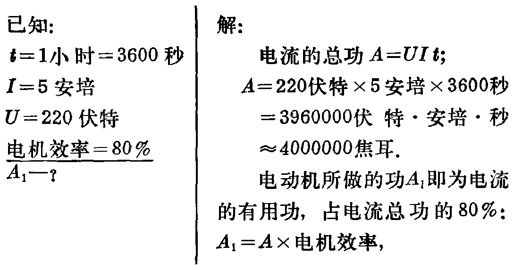

---
{
  "schema": "ld-s10y-lesson/page@3",
  "book": "7p",
  "page": 367,
  "printed_page": 356,
  "source": {
    "pdf": "6-7p 苏联中学课本 物理 六-七年级.pdf",
    "pdf_sha256": "46e2b2e4a92b7c00fab9adfc6a8a9b5340a9519fa90f1b82e79bc1e1432fcbb0",
    "pdf_page": 367
  },
  "render": {
    "dpi": 300,
    "w": 1472,
    "h": 2161,
    "sha256": "f23c602a8914194b1bbc0896c6e8c53bac5067aa8da4597f8b829598738ed1f1"
  },
  "profile": {
    "id": "soviet-cn",
    "sha256": "dad8d974ba16880482f359073263269de8c405ccf8cb17dc4215fad11da44849"
  },
  "notes": [
    "例题的双栏演算表作为一张无编号正文原图保存；已知栏、解栏、竖分隔线、效率下划线及全部公式均保留。表下两行公式独立转写，不并入表图。",
    "问题栏右侧页边的孤立微小墨迹不是文字；页码两侧的圆点为页脚装饰。"
  ],
  "errata": [],
  "printed_lines": 16,
  "figures": [
    {
      "id": "tbl-p0367-01",
      "label": "表",
      "box": [
        239,
        856,
        1065,
        549
      ]
    }
  ],
  "provenance": {
    "cap": "1",
    "normalized": true
  }
}
---

<!-- p cont -->
以秒来量度，所以可以写出：

<!-- p -->
**$1$焦耳$=1$伏特$\times1$安培$\times1$秒.**

<!-- p -->
如此说来，测量电功必须用三件仪器：伏特计、安培计和
时计。但实践中测量电功用的是一种专门仪器——**电度表**.
电度表的构造仿佛是综合了上述的三种仪器。现在，差不多
在每一户住宅中都可以看到电度表.

<!-- p -->
**例题。**如某电动机电路中的电流强度为$5$安培，两接线
柱间的电压为$220$伏特，试求电动机在$1$小时内所做的功.
已知电动机的效率为$80\%$.

<!-- fig 表 box 239,856,1065,549 -->

<!-- p -->
$A_1=\frac{4000000\text{ 焦耳}\times80\%}{100\%}=3200000$焦耳

<!-- p -->
$=3.2\times10^6$焦耳$=3.2\times10^3$千焦耳.

<!-- exhead -->
**问题**

<!-- ex 1 -->
$(1)$ 电流在一段电路中所做的功与电压及通过这段电路
的电量之间有什么关系？

<!-- ex 2 -->
$(2)$ 怎样用电压、电流强度及时间来表示电功？

<!-- foot -->
356
