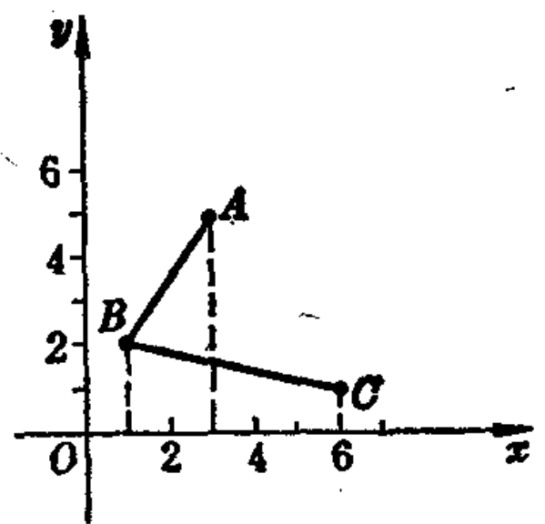

---
{
  "schema": "ld-s10y-lesson/page@3",
  "book": "8a",
  "page": 117,
  "printed_page": 110,
  "source": {
    "pdf": "8a 苏联十年制学校数学教材 代数 八年级.pdf",
    "pdf_sha256": "5978388efc80df4085400f80d5912f710efb052a806222633b172b0a9479b071",
    "pdf_page": 117
  },
  "render": {
    "dpi": 300,
    "w": 2480,
    "h": 3509,
    "sha256": "4de40d635127a34ca1d430c1ae9a9f911d3ea71e2a83b6a0af7f2adf5f5a9d55"
  },
  "profile": {
    "id": "soviet-cn",
    "sha256": "dad8d974ba16880482f359073263269de8c405ccf8cb17dc4215fad11da44849"
  },
  "notes": [
    "本批新网格只打开一次；印刷页110。排除图32后，正文、习题及标题22条实际印刷行、页脚1行，共23行。图32图题与题321第一行共排，cap用samerow，不重复计行。",
    "p0117#1承接p0116#8题320末尾“横坐标相”，先为“对应；”，随后б)共四行并在“图).”闭合。题321第一行被同排图题隔开，采用open、cap samerow、cont，未重复题号。",
    "实际N20最后对象为p0117#6题322；下一对象p0117#7标题“第三章 补充习题”是本批从新像素确认的右边界。边界后“第11小节和第12小节”及题323至326全部原样转录，不归入N20。",
    "从实际像素清点：插图1(图32)、子图1、表格0、图题1、坐标轴2(x与y)、点标签4(O、A、B、C)。图32属于题320所引用的同一折线，不是题321的作答图。",
    "图32源清点：原点O，正向x与y轴各有箭头；横轴印2、4、6，纵轴印2、4、6，各相邻整数位置有短刻线。点B在(1,2)，A在(3,5)，C在(6,1)；实线连接B-A及B-C，未连A-C。B、A、C各向横轴作竖向虚线，分别在x=1、3、6，无水平投影线。",
    "图32粗框1420,340,580,575，仅含坐标图，不含下方图题或左侧题面；交由现有finalize吸附，作者未裁图或重开图像。",
    "题326г)原印仅为分式(-1)^(n-1)/(2n)，未印c_n=，忠实保留，没有补写。页左侧竖线与孤立墨点为扫描噪声。",
    "仅RAW SOURCE作者转录，不构成独立来源批准；未组装、提升或现代化。"
  ],
  "errata": [],
  "printed_lines": 23,
  "figures": [
    {
      "id": "fig-32",
      "label": "图 32",
      "box": [
        1420,
        350,
        575,
        564
      ]
    }
  ],
  "provenance": {
    "cap": "1",
    "normalized": true
  }
}
---

<!-- ex 320 cont -->
对应；
б) 属于区间$[1,6]$的每一个实
数都和折线$ABC$上以这个数为
横坐标的一点相对应(同一个
图).

<!-- fig 图 32 box 1420,350,575,564 -->

<!-- ex 321 open -->
321. 作出函数$y=x^2-2x-15$的图

<!-- cap 图 32 samerow -->
图 32

<!-- ex 321 cont -->
象. 区间$[-1,6]$映射到什么集合上？

<!-- ex 322 -->
322. 证明下列各式的值是有理数：
а) $(5+2\sqrt{6})^2+(5-2\sqrt{6})^2$；
б) $(\sqrt{7+2\sqrt{10}}+\sqrt{7-2\sqrt{10}})^2$.

<!-- h3 -->
第三章　补充习题

<!-- exhead -->
第11小节和第12小节

<!-- ex 323 -->
323. 用列数对的方法给出下列有限数列：
а) $1,2,0,1,2,0$；　б) $3,7,7,-3,-7$.

<!-- ex 324 -->
324. 按照递增的顺序写出由数字的和等于3的三位数组成
的数列各项.

<!-- ex 325 -->
325. 写出下列数列的项：
а) 按照递增的顺序，分母是7的真分数；
б) 按照递减的顺序，分子是15的不可约假分数.

<!-- ex 326 -->
326. 写出用下列通项公式给出的数列$(c_n)$的前5项：
а) $c_n=\frac{n}{2n+1}$；　б) $c_n=\frac{5}{2^n+1}$；　в) $c_n=\frac{3^n-1}{3n-1}$；
г) $\frac{(-1)^{n-1}}{2n}$；　д) $c_n=\left(\frac{1}{n}\right)^{(-1)^n}$；　е) $c_n=\frac{1+(-1)^n}{n}$.

<!-- foot -->
· 110 ·
