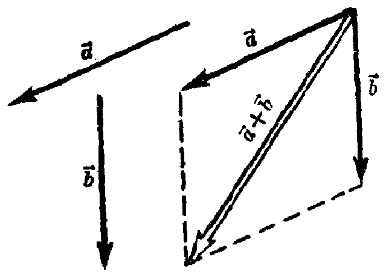
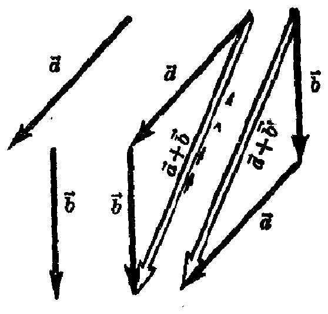
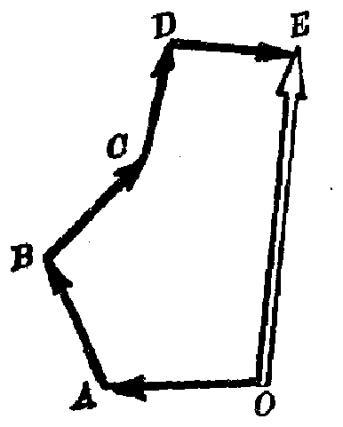
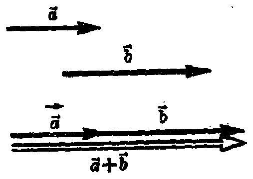

---
{
  "schema": "ld-s10y-lesson/page@3",
  "book": "8p",
  "page": 29,
  "printed_page": 17,
  "source": {
    "pdf": "8p 苏联中学课本 物理 八年级.pdf",
    "pdf_sha256": "4ec6a3d5fafe2c5c861a5053cf8cf047a3a6bd7988a4de799859d6a4fef8cc46",
    "pdf_page": 29
  },
  "render": {
    "dpi": 300,
    "w": 1695,
    "h": 2580,
    "sha256": "277393d2104824197d1cca21aa844e91ca2f3ab537c66a7cb1beed2d22608418"
  },
  "profile": {
    "id": "soviet-cn",
    "sha256": "ae373713f7b09f810d6de1e4a12b5916710e5673e4827148c875674f847f1e81"
  },
  "notes": [
    "2026-11-23 targeted reconstruction of the missing retained page for n5. Previous ownership/selection failures remain historical; this is not exact-byte recovery or independent approval. Captions15/16 share one row, as do17/18. The first and last prose blocks continue across page boundaries."
  ],
  "errata": [],
  "printed_lines": 13,
  "figures": [
    {
      "id": "fig-15",
      "label": "图 15",
      "box": [
        268,
        357,
        615,
        435
      ]
    },
    {
      "id": "fig-16",
      "label": "图 16",
      "box": [
        977,
        290,
        534,
        509
      ]
    },
    {
      "id": "fig-17",
      "label": "图 17",
      "box": [
        335,
        1627,
        362,
        457
      ]
    },
    {
      "id": "fig-18",
      "label": "图 18",
      "box": [
        969,
        1700,
        483,
        336
      ]
    }
  ],
  "provenance": {
    "cap": "1",
    "normalized": true
  }
}
---

<!-- fig 图 15 box 268,357,615,435 -->

<!-- cap 图 15 -->
图 15

<!-- fig 图 16 box 977,290,534,509 -->

<!-- cap 图 16 samerow -->
图 16

<!-- p cont -->
对角线，这条对角线就是两个矢量之和或合矢量.

<!-- p -->
两个矢量相加的另一种方法是：相加的两个矢量这样放
置：其中一个矢量的终点作为另一个矢量的起点. 两个矢量
的和是一个从第一个矢量起点指向第二个矢量终点的矢量
（图 $16$）. 如果需要相加的不是两个，而是更多的矢量，也是
应用这种方法. 所有相加的矢量这样放置：第一个矢量的终
点作为第二个矢量的起点，第二个矢量的终点作为第三个矢
量的起点，余此类推. 所有矢量的和或合矢量，是从第一个矢
量起点指向最后一个矢量终点的矢量（图 $17$）.

<!-- fig 图 17 box 335,1627,362,457 -->

<!-- cap 图 17 -->
图 17

<!-- fig 图 18 box 969,1700,483,336 -->

<!-- cap 图 18 samerow -->
图 18

<!-- p open -->
沿着同一直线方向的几个矢量（共线矢量）相加，也是根

<!-- foot -->
• *17* •
