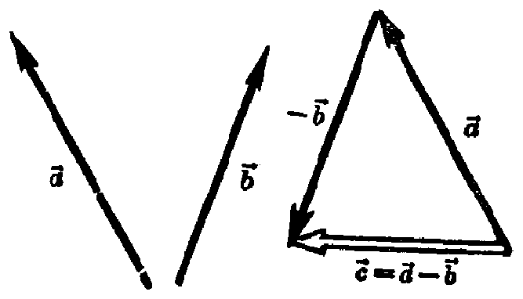
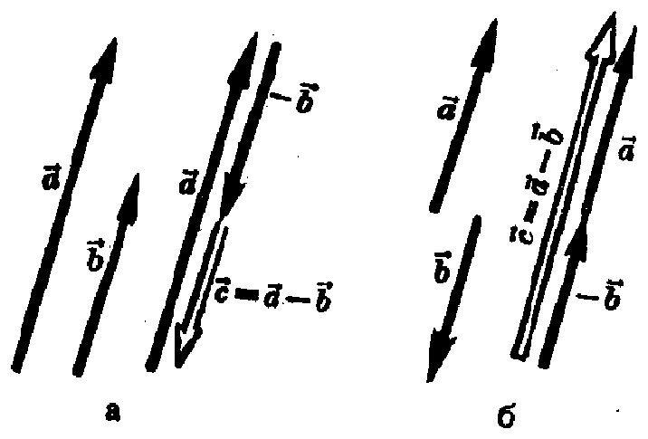

---
{
  "schema": "ld-s10y-lesson/page@3",
  "book": "8p",
  "page": 31,
  "printed_page": 19,
  "source": {
    "pdf": "8p 苏联中学课本 物理 八年级.pdf",
    "pdf_sha256": "4ec6a3d5fafe2c5c861a5053cf8cf047a3a6bd7988a4de799859d6a4fef8cc46",
    "pdf_page": 31
  },
  "render": {
    "dpi": 300,
    "w": 1695,
    "h": 2580,
    "sha256": "113a8c265f65849b8a1a8e8cb8b3f9ddcc72ec0e0df7e948520c8e4500f10646"
  },
  "profile": {
    "id": "soviet-cn",
    "sha256": "ae373713f7b09f810d6de1e4a12b5916710e5673e4827148c875674f847f1e81"
  },
  "notes": [
    "Only physical page 31 pixels read; inherited n5 identity is structure only, not a completion or catalog declaration.",
    "The internal heading 3 shares its printed row with prose and is not a new h3.",
    "Printed emphasis dots under the projection theorem are represented by separate under-dot spans on the two actual printed rows.",
    "Left-margin isolated scan blots are preserved in the source image, not transcribed as body text or masked as figures.",
    "The last prose row is open and continues onto physical page 32; footer is separate and closed."
  ],
  "errata": [
    {
      "id": "p0031-fig22a-arrow",
      "block": "p0031#4",
      "original": "共线矢量的减法，也按同样的法则计算（图22а，б）.",
      "reason": "Figure 22(a), source PNG sha256 1761ff0407f2b5b08d8395bdbe7198d145a4f9d2433495de0a40d861bcf83b33, prints a longer a and shorter b directed up-right, but its outlined c=a-b arrow points down-left. The difference must point with the longer a. This source-bound figure erratum is registered at its own prose-reference block: preserve raw prose and PNG; disclose the original arrow error in modern prose and reverse only the modern resultant arrow in subfigure (a). Independent source resolution is retained in n5/source-review-affected.md."
    }
  ],
  "printed_lines": 15,
  "figures": [
    {
      "id": "fig-21",
      "label": "图 21",
      "box": [
        566,
        269,
        643,
        358
      ]
    },
    {
      "id": "fig-22",
      "label": "图 22",
      "box": [
        553,
        984,
        692,
        461
      ]
    }
  ],
  "provenance": {
    "cap": "1",
    "normalized": true
  }
}
---

<!-- fig 图 21 box 566,269,643,358 -->

<!-- cap 图 21 -->
图 21

<!-- p -->
矢量$(-\vec{b})$的大小等于矢量$\vec{b}$的大小，其方向与矢量$\vec{b}$的方向
相反.

<!-- p -->
共线矢量的减法，也按同样的法则计算（图22а，б）.

<!-- fig 图 22 box 553,984,692,461 -->

<!-- cap 图 22 -->
图 22

<!-- p -->
如果我们需要求两个矢量$\vec{a}$和$\vec{b}$之差的投影，则跟矢量
加法的情况一样，不必作几何结构图. 不难证明：矢量差在轴
上的投影等于它们在该轴上投影的代数差.

<!-- p -->
**3. 矢量与标量的乘法**　矢量$\vec{a}$与标量$k$的乘积是一个
矢量，其大小等于矢量的模与标量因子的乘积：

<!-- p -->
$|k\vec{a}|=|k|\cdot|\vec{a}|$.

<!-- p -->
如果$k$是正的，则矢量$k\vec{a}$的方向与矢量$\vec{a}$相同；如果$k$是负
的，则矢量$k\vec{a}$的方向与矢量$\vec{a}$的方向相反.

<!-- p open -->
矢量$\vec{b}=k\vec{a}$在轴上的投影等于矢量$\vec{a}$在这个轴上的投影

<!-- foot -->
· *19* ·
