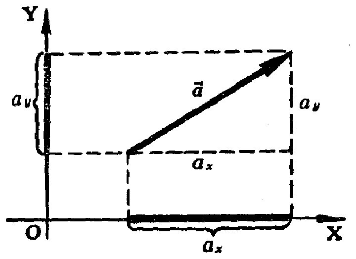

---
{
  "schema": "ld-s10y-lesson/page@3",
  "book": "8p",
  "page": 32,
  "printed_page": 20,
  "source": {
    "pdf": "8p 苏联中学课本 物理 八年级.pdf",
    "pdf_sha256": "4ec6a3d5fafe2c5c861a5053cf8cf047a3a6bd7988a4de799859d6a4fef8cc46",
    "pdf_page": 32
  },
  "render": {
    "dpi": 300,
    "w": 1695,
    "h": 2580,
    "sha256": "bda1f1493862f75a494012f4f313288b583cc75cae52b986ed0fabc18e0d9917"
  },
  "profile": {
    "id": "soviet-cn",
    "sha256": "dad8d974ba16880482f359073263269de8c405ccf8cb17dc4215fad11da44849"
  },
  "notes": [
    "Only physical page 32 pixels read, after completing page 31 authoring; first prose row continues p0031#11.",
    "The printed heading 6 is a source h3 boundary, not a catalog amendment or an assembled n5 completion claim.",
    "The uniform-motion definition retains first-row bold through 运动 and second-row bold on 做匀速直线运动; the period is outside emphasis.",
    "Isolated right-margin scan blots are preserved in the source image and are not body text or invented figures.",
    "The last prose row is open; no page 33 content was read.",
    "Figure 23 contains a non-origin-starting vector with two projections; source dashed and solid strokes are retained."
  ],
  "errata": [],
  "printed_lines": 19,
  "figures": [
    {
      "id": "fig-23",
      "label": "图 23",
      "box": [
        480,
        820,
        696,
        499
      ]
    }
  ],
  "provenance": {
    "cap": "1",
    "normalized": true
  }
}
---

<!-- p cont -->
乘以$k$：

<!-- p -->
$b_x=ka_x$.

<!-- p -->
总之，矢量的运算是根据几何法则. 矢量投影的运算也
是根据几何学的一般法则.

<!-- p -->
如果已知矢量$\vec{a}$在坐标轴上的投影$a_x$和$a_y$（图 23），则该
矢量的绝对值等于

<!-- p -->
$|\vec{a}|=\sqrt{a_x^2+a_y^2}$　（毕达哥拉定理）.

<!-- fig 图 23 box 480,820,696,499 -->

<!-- cap 图 23 -->
图 23

<!-- h3 -->
6. 匀速直线运动的位移

<!-- p -->
我们已经知道，为了求物体在任意时刻的位置，需要知道
位移矢量. 因为位移矢量与运动物体坐标的变化量有关，点
的位移矢量在坐标轴上的投影等于它的坐标的变化量.

<!-- p -->
究竟如何求位移矢量呢？为此需要知道什么呢？回答这
个问题是与物体做哪种运动有关.

<!-- p -->
让我们先讨论最简单的运动形式——匀速直线运动.

<!-- p -->
**物体在任意相等的时间里完成的位移都相等的运动**，叫
**做匀速直线运动**.

<!-- p open -->
当物体沿着一个方向做直线运动时，物体的位移不断地

<!-- foot -->
· *20* ·
