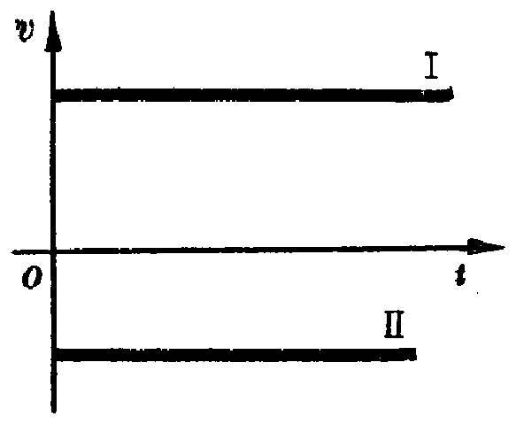
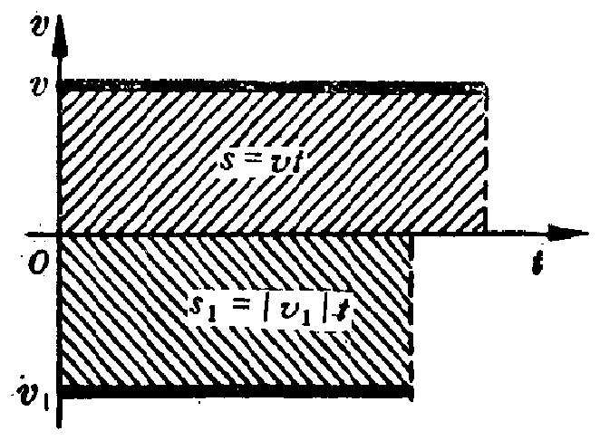

---
{
  "schema": "ld-s10y-lesson/page@3",
  "book": "8p",
  "page": 41,
  "printed_page": 29,
  "source": {
    "pdf": "8p 苏联中学课本 物理 八年级.pdf",
    "pdf_sha256": "4ec6a3d5fafe2c5c861a5053cf8cf047a3a6bd7988a4de799859d6a4fef8cc46",
    "pdf_page": 41
  },
  "render": {
    "dpi": 300,
    "w": 1695,
    "h": 2580,
    "sha256": "628dd826d9e95e660cb5f0352829ac83c34a5e7c4b36efba69b69defd80b0dc4"
  },
  "notes": [
    "页首承接物理页 0040 的速度图线说明。图 30 保留 I、II 两条水平图线及 v、t、0 标签；图 31 保留上下斜线区域、速度标签、时间 t 和原印面积式。图 30、图 31 的图题并排在同一印刷行，后者标 samerow。练习 5 本页仅含原印题 1、2，随后题续下一页；题 2 在本页完整。页左边缘孤立污斑不作为正文。"
  ],
  "errata": [],
  "profile": {
    "id": "soviet-cn",
    "sha256": "ae373713f7b09f810d6de1e4a12b5916710e5673e4827148c875674f847f1e81"
  },
  "printed_lines": 19,
  "figures": [
    {
      "id": "fig-30",
      "label": "图 30",
      "box": [
        257,
        717,
        559,
        455
      ]
    },
    {
      "id": "fig-31",
      "label": "图 31",
      "box": [
        865,
        697,
        638,
        462
      ]
    }
  ],
  "provenance": {
    "cap": "1",
    "normalized": true
  }
}
---

<!-- p cont -->
得到速度图线. 这种图线表示速度如何随时间变化，即速度
和时间的关系. 在匀速直线运动的情况下，这个“依赖关系”
是：速度不随时间改变. 因此，速度图线是平行于时间轴的
直线（图 30）. 图 30 上的图线 $\mathrm{I}$ 是属于物体向 $X$ 轴正方向运
动的情况. 图线 $\mathrm{II}$ 是属于向相反方向运动的情况（速度的投
影为负值）.

<!-- fig 图 30 box 257,717,559,455 -->

<!-- fig 图 31 box 865,697,638,462 -->

<!-- cap 图 30 -->
图 30

<!-- cap 图 31 samerow -->
图 31

<!-- p -->
根据速度图线，也可以知道物体在给定时间间隔内位移
的绝对值. 它的数值等于画细线的长方形面积（图 31）：如果
物体向正方向运动，则为上面的长方形面积；在相反情况下，
为下面的长方形面积. 实际上，长方形的面积等于它的两个
邻边的乘积. 但是，以一定比例的一个边等于时间 $t$，而另一
个边等于速度 $v$. 它们的乘积 $vt$ 恰好等于物体位移的绝
对值.

<!-- exhead -->
**练习 5**

<!-- ex 1 -->
1. 在图 29 上用虚线画的图线相当于什么运动？

<!-- ex 2 -->
2. 利用图线（参阅图 29），试求在 $t=3$ 秒时物体 2 和 4 之间的
距离.

<!-- foot -->
· ***29*** ·
