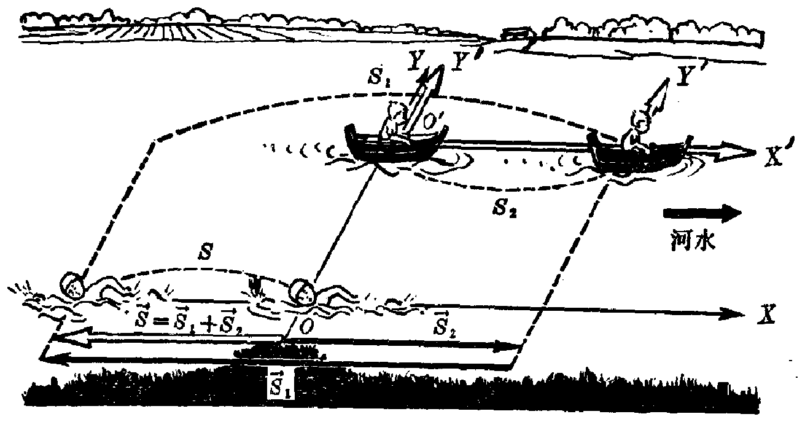

---
{
  "schema": "ld-s10y-lesson/page@3",
  "book": "8p",
  "page": 45,
  "printed_page": 33,
  "source": {
    "pdf": "8p 苏联中学课本 物理 八年级.pdf",
    "pdf_sha256": "4ec6a3d5fafe2c5c861a5053cf8cf047a3a6bd7988a4de799859d6a4fef8cc46",
    "pdf_page": 45
  },
  "render": {
    "dpi": 300,
    "w": 1695,
    "h": 2580,
    "sha256": "21be1e9bffe7b2dbfc7f9010da8febbc1726cffc87eb2a32ac1b0bd6217543cb"
  },
  "profile": {
    "id": "soviet-cn",
    "sha256": "ae373713f7b09f810d6de1e4a12b5916710e5673e4827148c875674f847f1e81"
  },
  "notes": [
    "页首公式承接第44页速度引导句。图34整体保留逆流游泳者、船、水流、河岸、坐标轴、位移标注及图内矢量等式，图题在图框下方独立计行。原印“静止不动的坐标系相对于运动坐标系的速度”忠实保留；字下着重点用粗体保留强调，不作为额外文字行。页底速度合成结论按原印粗体保留。扫描左边缘污斑不是正文。"
  ],
  "errata": [],
  "printed_lines": 15,
  "figures": [
    {
      "id": "fig-34",
      "label": "图 34",
      "box": [
        221,
        1261,
        1287,
        663
      ]
    }
  ],
  "provenance": {
    "cap": "1",
    "normalized": true
  }
}
---

<!-- p cont -->
$\vec{v}=\frac{\vec{S}}{t}=\frac{\vec{S}_1+\vec{S}_2}{t}=\frac{\vec{S}_1}{t}+\frac{\vec{S}_2}{t}$.

<!-- p -->
第一项 $\frac{\vec{S}_1}{t}$ ——游泳者相对于运动坐标系（船或水）的速度. 显
然，第二项 $\frac{\vec{S}_2}{t}$ ——船（水）相对于静止不动的坐标系（岸）的速
度. 我们用 $\vec{v}_2$ 表示它. 这就是说，$\vec{v}_2$ —— **静止不动的坐标系
相对于运动坐标系的速度**.

<!-- p -->
因此，
$\vec{v}=\vec{v}_1+\vec{v}_2$.

<!-- p -->
这个公式叫做速度合成公式.

<!-- p -->
假如游泳者逆流游泳（图 34），则在这种情况下，我们得
到完全一样的速度合成公式.

<!-- fig 图 34 box 221,1261,1287,663 -->

<!-- cap 图 34 -->
图 34

<!-- p -->
**物体相对于静止坐标系的运动速度等于下列两个速度的
几何和：物体相对于运动坐标系的速度和运动坐标系相对于
静止坐标系的速度**.

<!-- foot -->
· ***33*** ·
