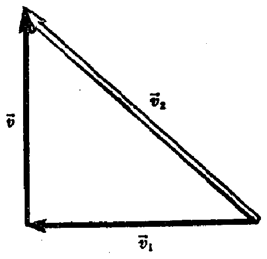

---
{
  "schema": "ld-s10y-lesson/page@3",
  "book": "8p",
  "page": 48,
  "printed_page": 36,
  "source": {
    "pdf": "8p 苏联中学课本 物理 八年级.pdf",
    "pdf_sha256": "4ec6a3d5fafe2c5c861a5053cf8cf047a3a6bd7988a4de799859d6a4fef8cc46",
    "pdf_page": 48
  },
  "render": {
    "dpi": 300,
    "w": 1695,
    "h": 2580,
    "sha256": "99df9f3d442d59a1e1fd9009ebcc749747ab14005608d05c45e5fb025d93176a"
  },
  "profile": {
    "id": "soviet-cn",
    "sha256": "ae373713f7b09f810d6de1e4a12b5916710e5673e4827148c875674f847f1e81"
  },
  "notes": [],
  "errata": [],
  "printed_lines": 25,
  "figures": [
    {
      "id": "fig-36",
      "label": "图 36",
      "box": [
        898,
        1718,
        507,
        491
      ]
    }
  ],
  "provenance": {
    "cap": "1",
    "normalized": true
  }
}
---

<!-- p cont -->
$X'O'Y'$ 的位移 $\vec{S}_1$ 和坐标系 $X'O'Y'$ 相对于静止坐标系 $XOY$
的位移 $\vec{S}_2$ 的几何和. 因此，像上一节所讨论的例子中的一样，
$\vec{S}=\vec{S}_1+\vec{S}_2$.

<!-- p -->
游泳者相对于坐标系 $XOY$ 的速度 $\vec{v}$ 等于：
$\vec{v}=\frac{\vec{S}}{t}=\frac{\vec{S}_1+\vec{S}_2}{t}=\frac{\vec{S}_1}{t}+\frac{\vec{S}_2}{t}$，
即
$\vec{v}=\vec{v}_1+\vec{v}_2$.

<!-- p -->
我们看到：速度合成的法则跟以前的一样. 然而，现在
的速度相加**不能用代数加法**，因为矢量 $\vec{v}_1$ 和 $\vec{v}_2$ 不是彼此平
行的.

<!-- p -->
在我们所讨论过的例子中，对于不同的坐标系，不仅游泳
者运动的速度，而且游泳者的轨迹都是不同的. 如果对于船
上的观察者来说，游泳者的运动轨迹是垂直于河流的直线，那
么，对于岸上的观察者来说，游泳者的运动轨迹是**与水流方向**
**有某一夹角（不等于 $90^\circ$）的斜线**. 这也是运动相对性的表现：
在彼此相对运动的不同坐标系中，运动的轨迹是不同的.

<!-- p -->
例题. 游泳者游泳过河，垂直到达对岸. 水流速度是
2 千米/小时，河宽 100 米. 如
果过河用 4 分钟，试求游泳者
相对于水的速度是多大？

<!-- p open -->
解：游泳者相对于岸的速
度 $\vec{v}$，等于水流速度 $\vec{v}_1$ 和游泳
者相对于水的速度 $\vec{v}_2$ 的矢量
和（图 36）. 矢量 $\vec{v}$ 的绝对值

<!-- fig 图 36 box 898,1718,507,491 -->

<!-- cap 图 36 samerow -->
图 36

<!-- foot -->
· ***36*** ·
