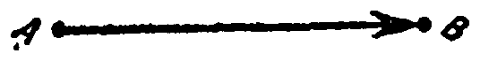
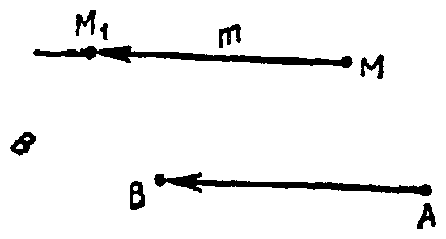

---
{
  "schema": "ld-s10y-lesson/page@3",
  "book": "9-10g",
  "page": 63,
  "printed_page": 56,
  "source": {
    "pdf": "9-10g 苏联十年制学校数学教材 几何 9-10年级.pdf",
    "pdf_sha256": "1900be5207d00404f64e5a40ab855fbfb8495bd2a06c5ce295ae0e145444578a",
    "pdf_page": 63
  },
  "render": {
    "dpi": 300,
    "w": 1506,
    "h": 2126,
    "sha256": "f83211d4d4952b88719cf5fb93f348ac2bfdbb9c53bf32080e2fb05c5b68d795"
  },
  "profile": {
    "id": "soviet-cn",
    "sha256": "dad8d974ba16880482f359073263269de8c405ccf8cb17dc4215fad11da44849"
  },
  "notes": [
    "SOURCE AUTHOR ONLY physical63, printed56. 从本页准备好的 page.grid.png 原始分辨率独立转写；第一稿不是独立审查批准。",
    "页首“样.”承接持久第62页末正文“在立体几何里，引入向量概念的方法，同平面几何里一”；不改第62页，不增删或迁移§16/§17标题。本页末句完整，但不代表§17结束。",
    "忠实保留向量（平移）、有序点对、不重合与重合的点对、距离竖线及零向量不引进方向的原文；正文射线AB、MM_1无箭头，向量AB、AA及小写a、b、c和零向量符号有箭头，表示长度的末行标量a无箭头。",
    "UNKNOWN source ink/glyph: 图67上方射线旁的手写标签有角状笔画，正文明确称射线m，但不据正文改画该标签；原始裁图保留实印笔画。图66下方约x200,y725处有孤立微小墨迹，语义归属UNKNOWN，不写成点名、标点或数学符号，不作计数排除。",
    "图66与图67各给一个粗框；两图图题共用一条印刷行，第二图题标记samerow。没有errata、count_exclusions、人工行数覆盖或来源纠错。"
  ],
  "errata": [],
  "printed_lines": 22,
  "figures": [
    {
      "id": "fig-66",
      "label": "图 66",
      "box": [
        206,
        650,
        512,
        45
      ]
    },
    {
      "id": "fig-67",
      "label": "图 67",
      "box": [
        686,
        504,
        527,
        272
      ]
    }
  ],
  "provenance": {
    "cap": "1",
    "normalized": true
  }
}
---

<!-- p cont -->
样.

<!-- p -->
研究由不重合的点组成的有序点对$(A, B)$. 它确定一条
始点为$A$和终点为$B$的有向线段(图66). 利用点对$(A, B)$可
给出空间的一个变换. 每一个点$M$的对应点$M_1$可由以下的
作法得到.

<!-- fig 图 66 box 206,650,512,45 -->

<!-- fig 图 67 box 686,504,527,272 -->

<!-- cap 图 66 -->
图 66

<!-- cap 图 67 samerow -->
图 67

<!-- p -->
把点$M$作为起点，作与射线$AB$同方向的射线$m$(图67).
在射线$m$上有唯一的点$M_1$，它和$M$的距离为$|AB|$. 这个作
法给出将点$M$映射成点$M_1$的空间变换.

<!-- p -->
定义. 如果一个空间变换将每一个点$M$映射成这样的
点$M_1$，射线$MM_1$与射线$AB$($A$、$B$是不重合的点)同方向，
且距离$|MM_1|$等于距离$|AB|$，那么这个空间变换叫做由不
重合的点对$(A, B)$确定的向量(平移).

<!-- p -->
由不重合的点对$(A, B)$给出的向量用符号$\overrightarrow{AB}$表示. 由射
线$AB$确定的方向叫做向量$\overrightarrow{AB}$的方向，而距离$|AB|$是向量
$\overrightarrow{AB}$的长度.

<!-- p -->
我们约定，任何重合的点对给出恒等变换，以后我们称它
为零向量. 零向量的长度等于零；对于它不引进方向的概念.
由点对$(A, A)$给出的零向量，用符号$\overrightarrow{AA}$表示.

<!-- p -->
也可用另外的符号$\vec{a}$，$\vec{b}$，$\vec{c}\cdots$表示向量；用$|\vec{a}|$或者$a$表示
向量$\vec{a}$的长度；$\vec{0}$表示零向量.

<!-- foot -->
· 56 ·
