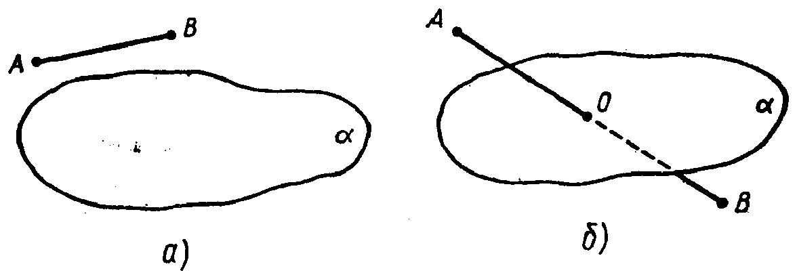

---
{
  "schema": "ld-s10y-lesson/page@3",
  "book": "9-10g",
  "page": 17,
  "printed_page": 10,
  "source": {
    "pdf": "9-10g 苏联十年制学校数学教材 几何 9-10年级.pdf",
    "pdf_sha256": "1900be5207d00404f64e5a40ab855fbfb8495bd2a06c5ce295ae0e145444578a",
    "pdf_page": 17
  },
  "render": {
    "dpi": 300,
    "w": 1506,
    "h": 2126,
    "sha256": "94b1cf93eed74e3c9124f3a22d7b321725588e53f3d640227ca5e5671a379387"
  },
  "profile": {
    "id": "soviet-cn",
    "sha256": "dad8d974ba16880482f359073263269de8c405ccf8cb17dc4215fad11da44849"
  },
  "notes": [
    "完整单张原PNG确认物理17为印刷10页；首行明不存在续物理16末学生自己证，用p cont闭合。同页2．是§3内正文编号，未另开单元。",
    "第二段实际印为平面alpha将这个平面分成两个非空的子集，保留这个平面，不按数学推理换为空间；半开空间、半闭空间、同侧和异侧文字均照原印。图10小图字母以西里尔а、б保留。",
    "图10两小图共一粗框，含全部点名、平面边界、实虚线及小图字母，不含独立图题。凸图形后的星号和本页两行教学脚注完整保留。",
    "首续文1行、半开空间段4行、性质1两行、性质2两行、同侧异侧段4行、图题1行、半闭空间定义2行、凸图形句1行、教学脚注2行、两侧圆点页脚1行，共20个印刷横排。本页无open末段，不预置count_exclusions。"
  ],
  "errata": [],
  "printed_lines": 20,
  "figures": [
    {
      "id": "fig-10",
      "label": "图 10",
      "box": [
        125,
        1144,
        1152,
        388
      ]
    }
  ],
  "provenance": {
    "cap": "1",
    "normalized": true
  }
}
---

<!-- p cont -->
明不存在通过两条已知直线的其它平面．

<!-- p -->
2．假设已知平面 $\alpha$．研究空间里不属于 $\alpha$ 的所有的点的
集合．平面 $\alpha$ 将这个平面分成两个非空的子集，它们叫做以
$\alpha$ 为边界的半开空间．对于半开空间的以下性质，我们不作
证明就承认它们的正确性（图10，а，б）：

<!-- p -->
1．连结半开空间中的任意两点的线段和它的边界不相
交．

<!-- p -->
2．连结分别属于有共同边界的两个半开空间的任意两
点的线段，和这个边界相交．

<!-- p -->
如果点 $A$ 和 $B$ 属于以 $\alpha$ 为边界的半开空间，那么说，$A$ 和
$B$ 位于平面 $\alpha$ 的同一侧（图10，а）．如果 $A$ 和 $B$ 属于有公共边
界 $\alpha$ 的不同的半开空间，那么 $A$ 和 $B$ 位于平面 $\alpha$ 的异侧（图
10，б）．

<!-- fig 图 10 box 125,1144,1152,388 -->

<!-- cap 图 10 -->
图 10

<!-- p -->
半开空间和它的边界的并集叫做半闭空间（或简称半空
间）．

<!-- p -->
半空间是凸图形$^{*}$．

<!-- foot note -->
* 凸图形的定义是平面几何中的定义在空间图形中的推广：如果一个图
形包含连结它任意两点的线段，这个图形叫做凸图形．

<!-- foot -->
· 10 ·
