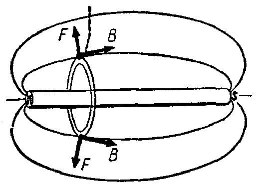
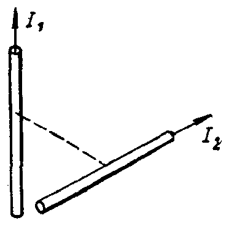

---
{
  "schema": "ld-s10y-lesson/page@3",
  "book": "9p",
  "page": 303,
  "printed_page": 294,
  "source": {
    "pdf": "9p 苏联中学课本 物理 九年级.pdf",
    "pdf_sha256": "df0ea9c3417b7ba0166872b33a8ec81ef20cfb9e15b512a44993174fe92162c0",
    "pdf_page": 303
  },
  "render": {
    "dpi": 300,
    "w": 1504,
    "h": 2289,
    "sha256": "fb642fab6f14fddf55248c5e0924222c2b4325b86e248ab8a2d0c0ed52beea14"
  },
  "profile": {
    "id": "soviet-cn",
    "sha256": "c364d68442cfccc9920d3e23932d418c3d7b123cf4a47408e6535dcb19f7104a"
  },
  "notes": [
    "AUTHOR only. This page continues the 练习 15 column begun on page0302, with exercises6 through11; no repeated exercise heading is printed.",
    "Figure277 precedes exercise6 but is explicitly referenced by page0302 exercise5. Figure278 is referenced by this page exercise6. Do not assign figure277 to the nearest exercise6.",
    "Figure277 retains the source apparatus and visible F/B glyphs exactly as pixels. No north/south pole labels or obscured/missing characters are inferred.",
    "The two figure captions occupy one shared printed row.",
    "Exercises6 through11 are complete questions. The final nontransparent block is exercise11, ending 磁感应强度 B 等于什么？ with the printed vector over B retained in the transcription.",
    "No h1/h2/h3 or next numbered source-unit heading is observed. A complete last question and the large blank lower page do not prove closure of source122 or of the entire exercise column; page0304 has not been read.",
    "The real footer is • 294 •. Edge shadows and isolated scan marks are not printed text."
  ],
  "errata": [],
  "printed_lines": 14,
  "figures": [
    {
      "id": "fig-277",
      "label": "图 277",
      "box": [
        177,
        274,
        493,
        353
      ]
    },
    {
      "id": "fig-278",
      "label": "图 278",
      "box": [
        953,
        260,
        349,
        345
      ]
    }
  ],
  "provenance": {
    "cap": "1",
    "normalized": true
  }
}
---

<!-- fig 图 277 box 177,274,493,353 -->

<!-- fig 图 278 box 953,260,349,345 -->

<!-- cap 图 277 -->
图 277

<!-- cap 图 278 samerow -->
图 278

<!-- ex 6 -->
6. 两个交叉成直角的直导体分别通有电流 $I_1$ 和 $I_2$（图 278）。两个
导体的相对位置将如何改变？

<!-- ex 7 -->
7. 利用右螺旋法则和左手定则，证明方向相同的平行电流相互吸
引，而方向相反的平行电流相互排斥。

<!-- ex 8 -->
8. 例题 2 中的通电线圈，其法线与磁力线的夹角为 $45^\circ$（图 251）。
试求磁场对线圈的作用力矩。

<!-- ex 9 -->
9. 长 $l=0.15$ 米，通电 $I=8$ 安培的导体，垂直于 $B=0.4$ 特斯拉的
匀强磁场的磁力线。试求当导体沿着安培力的方向移动 $0.025$ 米时所
做的功。

<!-- ex 10 -->
10. 试求例题 3 中所谈的粒子沿螺旋线运动的螺距。

<!-- ex 11 -->
11. 电子在同时存在有恒定的匀强电场和匀强磁场的空间中，沿
直线轨道运动。已知电场强度等于 $\vec{E}$，磁感应强度 $\vec{B}$ 等于什么？

<!-- foot -->
• 294 •
