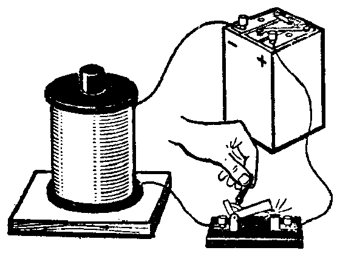

---
{
  "schema": "ld-s10y-lesson/page@3",
  "book": "9p",
  "page": 321,
  "printed_page": 312,
  "source": {
    "pdf": "9p 苏联中学课本 物理 九年级.pdf",
    "pdf_sha256": "df0ea9c3417b7ba0166872b33a8ec81ef20cfb9e15b512a44993174fe92162c0",
    "pdf_page": 321
  },
  "render": {
    "dpi": 300,
    "w": 1504,
    "h": 2289,
    "sha256": "187e984bc89dca0fd5a8371de1d2c773e2b4260cc10141ced55b4ef389f861e6"
  },
  "profile": {
    "id": "soviet-cn",
    "sha256": "c364d68442cfccc9920d3e23932d418c3d7b123cf4a47408e6535dcb19f7104a"
  },
  "notes": [
    "D077 first-author transcription from physical321 page.grid.png, opened once. Parent context reaches24 image opens; no crop or native SVG preview is reopened by the parent.",
    "Incoming first two rows continue320 ending I，. A new paragraph has seven rows wrapping left of295, its caption shares the seventh row, then two full-width rows close it.",
    "Figure295 is the original complete coil/core on a base, battery with top terminals and polarity marks, connecting wires, knife-switch base with contacts, hand at its operating lever and spark strokes at the contact. Source crop must preserve all apparatus, labels, hand and spark, without prose/caption. RAW and SVG independent inspection remain pending; no hand-action or modern-figure approval is inferred.",
    "Equation12-9 remains W=LI^2/2, with its full fraction on one printed row. Prior kinetic-energy fraction also occupies one printed row. Bold 磁场能量密度 is preserved without extending emphasis into the parenthetical explanation.",
    "Last paragraph ends open at 成 toward322. No subsequent heading or whole131 closure is invented. No exercise/footnote is printed. Low full stops are ASCII dots; footer312 is heavy/slanted."
  ],
  "errata": [],
  "printed_lines": 25,
  "figures": [
    {
      "id": "fig-295",
      "label": "图 295",
      "box": [
        736,
        348,
        536,
        398
      ]
    }
  ],
  "provenance": {
    "cap": "1",
    "normalized": true
  }
}
---

<!-- p cont -->
电源就要反抗涡旋电场的力做功. 这个功用来增大电流的能
量. 此时，涡旋电场做负功.

<!-- p open -->
正如我们曾知道的，电
路中的电流不是立刻达到确
定值的；电流逐渐增大，直
到单位时间内电源所消耗的
所有能量只用来放出热量时
为止. 当断开电路，电流消
失时，贮存在电流中的能量

<!-- fig 图 295 box 736,348,536,398 -->

<!-- cap 图 295 samerow -->
图　295

<!-- p cont -->
都被放出. 从有强电感的电路中发生的火花（图295），可以
看出这一点.

<!-- p -->
根据在§129中所谈到的惯性和自感的类比，可以写出
具有电感$L$的电路里电流的能量表示式.

<!-- p -->
如果自感类似于惯性，则自感在产生电流过程中的作用
应当跟力学中在物体获得加速度时质量的作用相似. 作为表
征电荷运动的量的电流强度$I$，起着力学中物体速度的作用.

<!-- p -->
如果是这样，则类似于力学中物体的动能等于$\frac{mv^2}{2}$，可以
把电流的能量$W$写成如下形式：

<!-- p -->
$W=\frac{LI^2}{2}$.　(12-9)

<!-- p -->
用计算的方法得到的电流能量的表示式与此相同.

<!-- p open -->
电流的能量(12-9)是用导体的几何特性$L$和导体中的电
流强度$I$表示的. 但是，也可以用场的特性表示这个能量. 计
算表明，类似于电场能量密度跟电场强度的平方成正比一样，
**磁场能量密度**（即单位体积的能量）跟磁感应强度的平方成

<!-- foot -->
• *312* •
